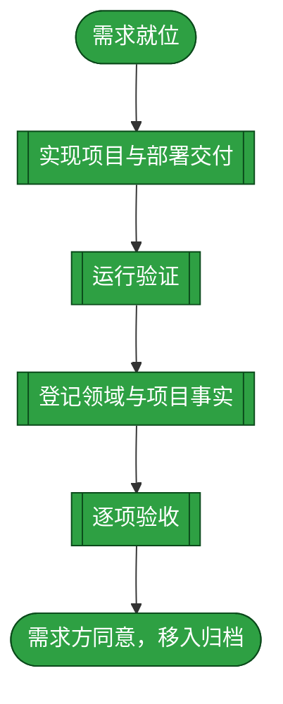
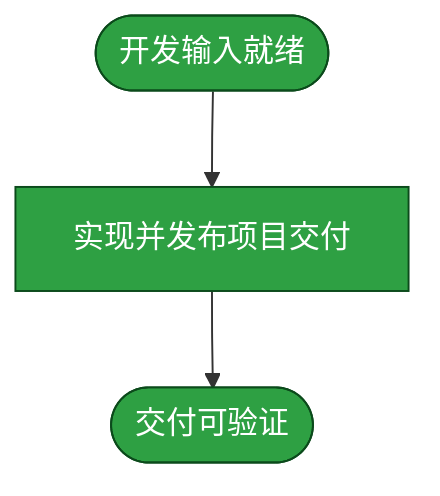
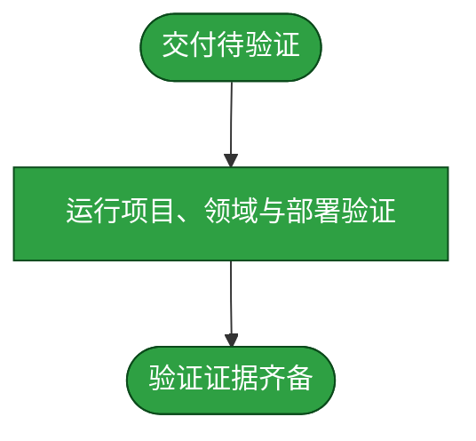
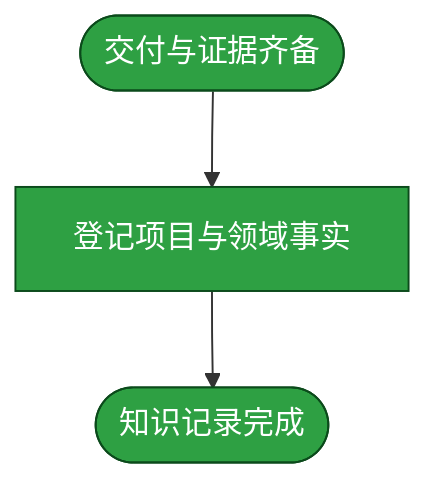
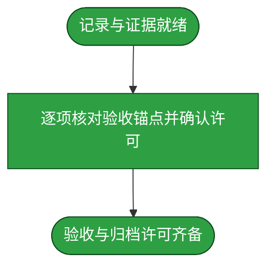

# 需求：发布可配置的 DSH Docker 镜像并由 Unraid 模板部署

```yaml
target: "assets/projects/docker-for-dsh/；assets/domain-knowledge/dsh-docker/"
output: "GitHub yunjies/docker-for-dsh、GHCR 镜像、Unraid Docker 模板，以及领域知识登记"
prompt:
  - "我觉得docker本身已经在沙箱中了，在沙箱中用root非常合理"
  - "修正规则：\n1. 持久目录调整为/mnt/user/appdata/dsh-sec\n2. 目前dsh docker安装插件会报错，意思还是权限问题，报错信息是：✓ Lockfile passes supply-chain policies (verified 23h ago)\nProgress: resolved 1, reused 0, downloaded 0, added 0\n[ERR_PNPM_GIT_DEP_PREPARE_NOT_ALLOWED] Failed to prepare git-hosted package fetched from \"https://codeload.github.com/Phant0Meow/dsh-meow-memory/tar.gz/d531575ef6adaf562e06d49cb84a2c73b66ce6db\": The git-hosted package \"meow-memory@0.31.1\" needs to execute build scripts but is not in the \"allowBuilds\" allowlist.\n\nThis error happened while installing a direct dependency of /data/.dsh/profiles/web\n\nAdd the package to \"allowBuilds\" in your project's pnpm-workspace.yaml to allow it to run scripts. For example:\nallowBuilds:\n  meow-memory@https://codeload.github.com/Phant0Meow/dsh-meow-memory/tar.gz/d531575ef6adaf562e06d49cb84a2c73b66ce6db: true\n3. 本docker应该是一个壳，需要配置dsh版本（lastest表示最新版，默认是lastest），每次启动都会启动对应版本的dsh\n4. 还是保留codex插件的安装"
  - "假设我现在要新建一个dsh docker 二号，如何接入ttswitch"
  - "ACL 要按单个 IP 还是整个可信私网配置。"
  - "IP配置开放的到docker配置中或者appdata中的明文配置文件里"
  - "dsh-docker-probe改名交dsh-sec"
  - "将dsh docker源码上传到https://github.com/yunjies/docker-for-dsh （这里在project中新增仓库， 在领域知识中新开领域）。然后配置github配置，自动生成镜像。然后在unraid中直接通过github链接进行部署"
```

本流程将 `docker-for-dsh` 项目、`dsh-docker` 领域登记、公开 GHCR 构建和 Unraid 部署推进到验收并获准归档。项目内容留在需求方确认的 `duoduo` 分支；项目自身源码仓库使用 `main`。

## 需求澄清

### 澄清记录

- 问答：知识库内容使用哪个非 `main` 分支？ → 使用当前 `duoduo` 分支。裁决：只在该分支添加本项目和领域内容，并保留原有工作区改动；项目自身 GitHub 仓库使用 `main`。反论与代价：项目知识暂不在知识库 `main`；同步时须遵守项目内容分支策略。验收面：知识库改动留在已确认内容分支，已有未跟踪文件未被覆盖或移除。
- 问答：GitHub/GHCR 镜像可见性如何设置？ → 公开 GHCR 镜像。裁决：公开源码和镜像不包含用户配置、TTSwitch 路由 UUID、token、凭据文件或私人主机地址。反论与代价：任何人均可读取公开镜像；只发布通用构建产物和示例配置。验收面：公开产物无上述私密值，且匿名拉取成功。
- 问答：Unraid 通过哪种 GitHub 入口部署？ → 提供 Unraid Docker template XML。裁决：模板引用公开 GHCR 镜像，持久数据及 workspace 落在 `/mnt/user/appdata/dsh-sec/` 下，并提供 DSH 版本、网络、端口和 token 注册配置。反论与代价：目标主机须预先具备 `dsh-private` 网络。验收面：模板可解析并引用真实镜像，DockerMan 能加载模板。
- 问答：是否允许 `meow-memory@0.31.1` 的 Git prepare/build 脚本？ → 仅授权 prompt 所列 GitHub commit。裁决：仅在对应 DSH profile 的 `pnpm-workspace.yaml` 放行该精确 Git source，Codex 插件保持独立安装。反论与代价：脚本以容器 root 执行且可写挂载数据与 workspace；授权不扩展到其他包。验收面：allowBuilds 精确匹配 commit，安装日志通过 lockfile policy，且未读取、输出或提交 credentials。

### 验收锚点

- A1：GitHub `yunjies/docker-for-dsh` 的 `main` 提供可复算的 Dockerfile、启动脚本、版本选择逻辑、README 和 Unraid template，且无机密源码。
- A2：GitHub Actions 对 `main` 构建成功并推送公开 GHCR `linux/amd64` 镜像，匿名 pull 成功。
- A3：公开源码、workflow、template 与镜像层不含 TTSwitch 路由 UUID、VM 私有地址、API key、DSH credential store、token map 或用户日志。
- A4：持久数据从旧位置迁移到 `/mnt/user/appdata/dsh-sec/data` 与 `/workspace`；Codex subscription 插件仍在 profile，启动时 DSH 版本与 `DSH_VERSION` 解析结果一致。
- A5：GitHub raw Unraid template 指向 GHCR 镜像与 `/mnt/user/appdata/dsh-sec` 持久路径；活动 Unraid 容器使用 GHCR `latest`，按 `DSH_VERSION` 选择 DSH，已配置的 token registrar 收到启动 token。TTSwitch 是可选服务，只有用户选择接入时才要求验证 provider 调用。
- A6：领域 catalog 登记 `dsh-docker` 与 `docker-for-dsh`，manifest 引用项目源码和 domain tests，领域固定 runner/lint 判据通过。

### 范围边界

- 不公开当前 DSH `.credentials.yaml`、TTSwitch route UUID/API key、VM 地址/密钥、Nginx token map、日志或专用真实 `cordis.patch.yml`。
- 不自动执行 `meow-memory` 以外的未知 npm/pnpm build scripts；精确 commit 之外的脚本须单独审核和授权。
- 不修改 TTSwitch 主容器、Nginx、VM 服务配置或 GitHub 凭据存储。
- 不提交或推送知识库根仓库；资料留在已确认的 `duoduo` 内容分支，除非需求方另行要求。

## 主流程图



## START

需求范围、验收锚点和已确认的 `duoduo` 内容分支已明确，可以执行。

**输入**

- `REQ_SPEC`：前置块与需求澄清所载规格；来源为本文。

**输出**

- `REQ_SPEC`：已确认规格；去向为 `DEVELOP`。

## DEVELOP

该阶段交付项目仓库、GHCR workflow、Unraid template 与运行所需配置。公开产物只含通用内容，并仅按精确授权处理 `meow-memory` build script。项目源码仓库 `main` 的交付 commit 为 `30f29ae6136431afd9419dafcacff07c58ae2f79`。



### DEV_START

本节点接收已澄清的需求规格，作为项目实现的约束。

**输入**

- `REQ_SPEC`：已确认规格；来源为 `START`。

**输出**

- `BUILD_SCOPE`：实施边界与授权；去向为 `DEV_BUILD`。

### DEV_BUILD

本节点交付项目源码、自动构建配置、Unraid template 与运行配置，并遵守公开内容和构建脚本授权边界。

**输入**

- `BUILD_SCOPE`：实施边界与授权；来源为 `DEV_START`。

**输出**

- `DELIVERY`：项目源码与部署交付；去向为 `DEV_DONE`。

### DEV_DONE

源码仓库、镜像构建配置、模板和运行所需配置均已形成可供验证的交付。

**输入**

- `DELIVERY`：项目源码与部署交付；来源为 `DEV_BUILD`。

**输出**

- `DELIVERY`：待验证交付；去向为 `TEST`。

## TEST

本阶段检验项目、领域和实际部署的证据，并保留未验证面的边界。GitHub Actions run `40089960971` 成功；GHCR `latest` 匿名拉取成功，digest 为 `sha256:5c57914733898b12de925d99874b7444b415c6eaedcce3a520744ec79167903f`。Unraid 上 `dsh-sec` 使用 `ghcr.io/yunjies/docker-for-dsh:latest`，挂载为 `/mnt/user/appdata/dsh-sec/data -> /data` 与 `/mnt/user/appdata/dsh-sec/workspace -> /workspace`；`DSH_VERSION=latest`，DSH 为 `0.2.1-rc.2`，Codex 为 `3.1.4`。token registrar 启动注册成功；`.credentials.yaml` 权限为 `600`。网络为 `dsh-private`，容器地址 `172.29.250.3`。旧容器 `dsh-sec-before-ghcr` 与旧 appdata 保留供回滚。

领域 runner/lint 验证通过，需求 provenance 检查及项目/领域测试通过。知识库根 `_lint` 有三项失败，均限于原有且与本需求无关的未跟踪归档文档 `assets/archive/req.dsh-credentials.ssh-target-aliases.20261023-232859.md`；其来源未修改。

未提供启动认证时 DSH 直连端口返回 HTTP 401。Unraid 主机对配置的公开代理探测返回状态 000，因此外部浏览器代理登录未验证；该面不属于验收要求。TTSwitch 为可选接入，本次未调用模型。



### TEST_START

本节点接收已实现的交付，界定要验证的对象。

**输入**

- `DELIVERY`：项目源码与部署交付；来源为 `DEVELOP`。

**输出**

- `TEST_SCOPE`：本阶段验证对象；去向为 `TEST_RUN`。

### TEST_RUN

本节点运行并核对项目、领域与部署验证，记录成功证据以及不属于验收范围的未验证面。

**输入**

- `TEST_SCOPE`：本阶段验证对象；来源为 `TEST_START`。

**输出**

- `TEST_EVIDENCE`：验证证据及未验证面；去向为 `TEST_DONE`。

### TEST_DONE

本节点形成可交接的验证记录，并保留根 lint 的既有无关失败事实，不将其描述为本需求通过。

**输入**

- `TEST_EVIDENCE`：验证证据及未验证面；来源为 `TEST_RUN`。

**输出**

- `TEST_EVIDENCE`：验证结果；去向为 `ARCHIVE` 与 `ACCEPT`。

## ARCHIVE

本阶段将已实现的项目与领域事实写入各自知识归属，并确认领域测试记录与交付事实一致。领域 catalog 登记 `dsh-docker` 与 `docker-for-dsh`，manifest 引用项目源码和 domain tests；相关领域测试通过。根 lint 的既有无关失败单独保留记录。



### ARC_START

本节点接收开发交付与验证证据，作为项目及领域知识记录的事实依据。

**输入**

- `DELIVERY`：项目与部署交付；来源为 `DEVELOP`。
- `TEST_EVIDENCE`：验证证据及未验证面；来源为 `TEST`。

**输出**

- `RECORD_INPUT`：经验证的交付事实；去向为 `ARC_RECORD`。

### ARC_RECORD

本节点将项目与领域事实登记至相应目录，并使 manifest、源码引用及 domain tests 引用与实际交付对应。

**输入**

- `RECORD_INPUT`：经验证的交付事实；来源为 `ARC_START`。

**输出**

- `ARCHIVED`：与交付事实一致的项目及领域记录；去向为 `ARC_DONE`。

### ARC_DONE

项目与领域记录已形成，且内容与交付及验证证据一致。

**输入**

- `ARCHIVED`：项目及领域记录；来源为 `ARC_RECORD`。

**输出**

- `ARCHIVED`：已落档记录；去向为 `ACCEPT`。

## ACCEPT

本阶段逐项核对 A1–A6。项目仓库、Actions、匿名 GHCR pull、活动 Unraid 容器、持久挂载、版本选择、Codex、token 注册及领域登记均有证据。外部代理登录与可选 TTSwitch 模型调用不作为必需项。私密配置不纳入公开产物，旧容器及 appdata 保留回滚。需求方明确表示“部署完成，先归档docker需求”，接受技术交付并请求归档。



### ACC_START

本节点接收领域记录与测试证据，作为逐项验收的输入。

**输入**

- `ARCHIVED`：已落档记录；来源为 `ARCHIVE`。
- `TEST_EVIDENCE`：逐项验收证据；来源为 `TEST`。

**输出**

- `ACCEPT_INPUT`：待核对的记录与证据；去向为 `ACC_CHECK`。

### ACC_CHECK

本节点对照 A1–A6 核验各项证据，并确认需求方已明确同意归档。未把代理外部登录或可选 TTSwitch 调用作为验收前提。

**输入**

- `ACCEPT_INPUT`：待核对的记录与证据；来源为 `ACC_START`。

**输出**

- `ACCEPTANCE_EVIDENCE`：验收结果与需求方归档许可；去向为 `ACC_DONE`。

### ACC_DONE

验收锚点均有相应证据，且需求方明确请求归档。

**输入**

- `ACCEPTANCE_EVIDENCE`：验收结果与归档许可；来源为 `ACC_CHECK`。

**输出**

- `ACCEPTED`：验收通过及归档许可；去向为 `DONE`。

## DONE

所有完成路径节点均已执行并标绿。按归档规则，将本文整篇移动到 `assets/archive/`，文件名保持不变；移动后不修改归档文件。本操作不提交或推送 Git 变更。

**输入**

- `ACCEPTED`：验收通过并获需求方明确许可；来源为 `ACCEPT`。

**输出**

- `ARCHIVE_MOVE`：整篇文档移动至归档目录；去向为流程外部的归档操作。
