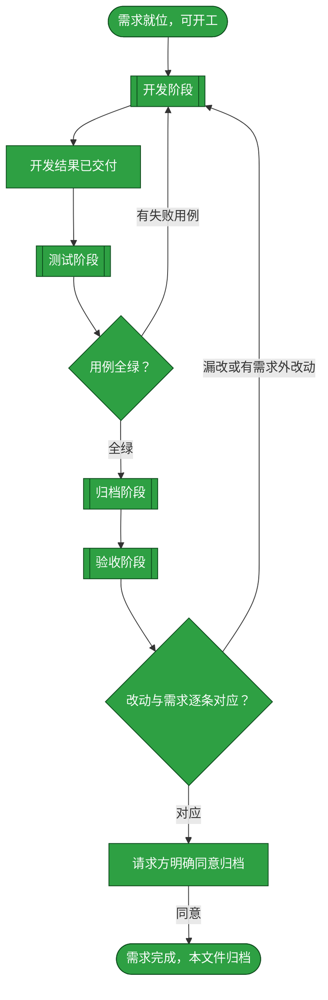
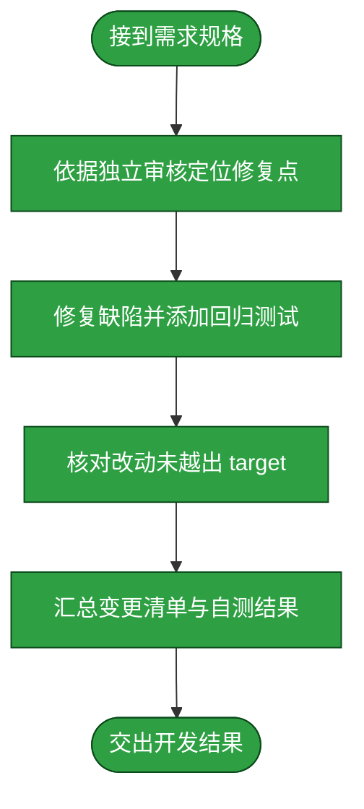
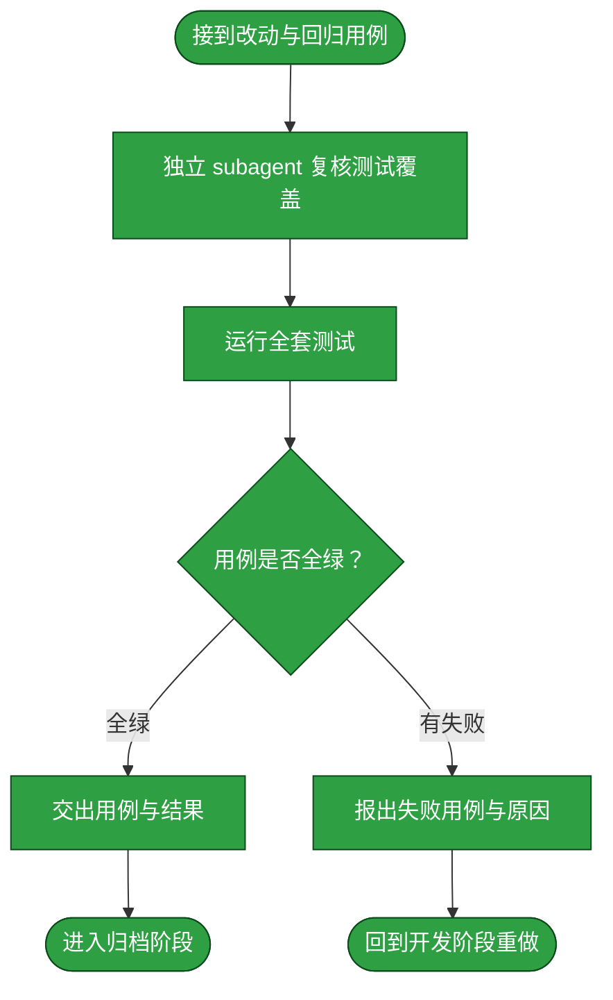
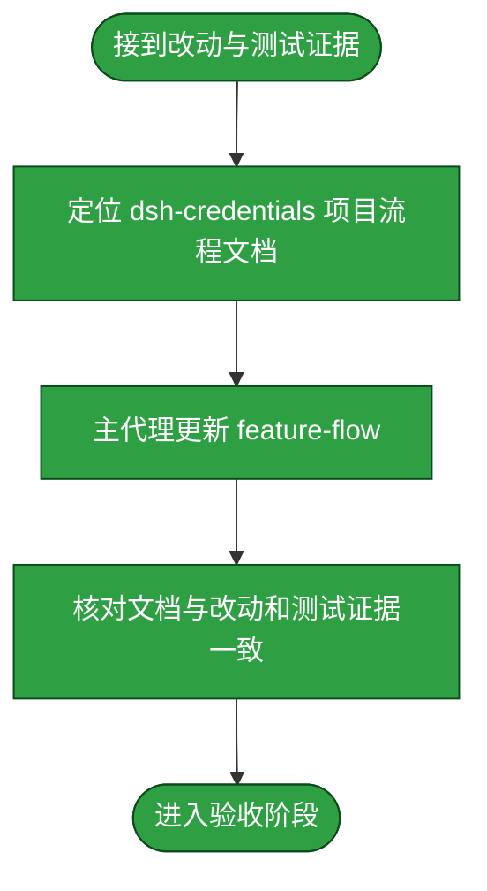
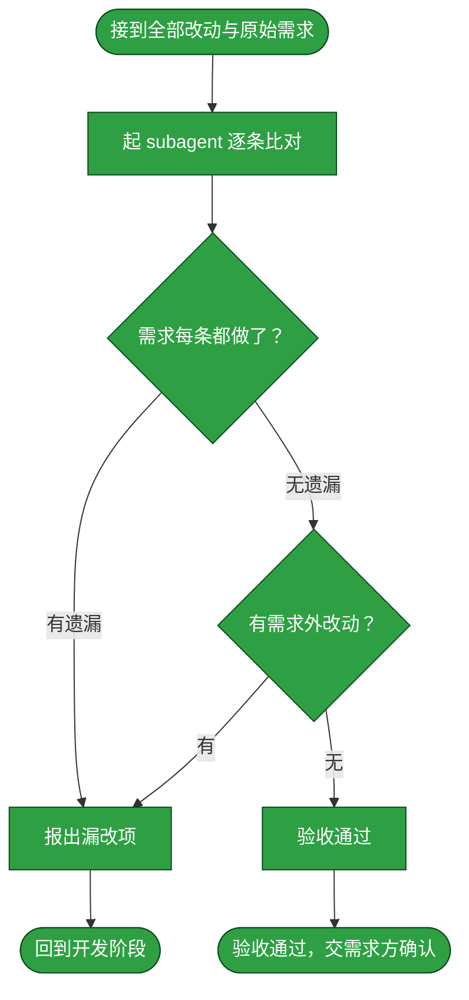

# 需求：扩展 dsh-credentials 的 HTTP 自定义服务、认证验证与删除

```yaml
target: assets/projects/dsh-credentials/
output: assets/projects/dsh-credentials/ 的自定义 Web 服务实现、测试、截图探针与说明，以及 assets/domain-knowledge/dsh-credentials/feature-flow.md 中对应的 HTTP 服务流程
prompt:
  - "dsh-credentials 现在需要扩展HTTP登录方式的配置，允许支持HTTP链接+用户名密码，或者HTTP+apikey的形式"
  - "这个没问题，我怎么新增一条配置以及配置他的昵称呢，只能设置已有的两条"
  - "那不是jellyfin 换一个服务，还能自动生效么"
  - "你来一个完整测试，顺便带上设置界面的测试截图"
  - "192.168.1.217:8096连接失败"
  - "那你修复一下"
  - "http功能开发完成了，可以归档"
```

本需求从一组只能由代码预置的 Web 登录行，推进到用户可自行新增、改名、验证和移除的 Web 服务。秘密仍由凭证 seam 保存；服务身份和登录公开元数据保存在插件设置文档；重启后的代码加载、服务数据的热更新、探测结论和部分删除失败均需有可观察且不误导用户的行为。

## 需求澄清

本节记录 prompt 原话里下游阶段不能自行推断的裁决。最初只说“HTTP + basic 或 apikey”；后续需求方明确要求服务完全用户自定义，并明确要求修复验收发现的删除、探测与超时缺陷。

### 澄清记录

- 问答：向需求方确认 HTTP 登录要落在哪类能力 → “Web 服务类凭证（可选 basic-auth 用户名密码 或 apikey，配合一个 URL 端点）”
  - 裁决：服务是凭证目录中的自定义 Web 服务，不是 LLM provider，也不是任意 URL 目标扫描；Basic 与 Bearer 两种认证都由用户声明。
  - 反论与代价：自定义服务不再有可直接看到的预置范例，首次使用须由用户知道服务名称和路径；这是避免向用户提供错误预置项的代价。
  - 验收面：空 Web 分组可新增 Basic 或 Bearer 服务，创建后显示用户昵称、端点与账号（Basic）。被消歧位置：prompt 中“HTTP 登录方式”。
- 问答：需求方指出只能设置已有两条，并问如何新增及配置昵称 → “都是自定义的”；又问换服务是否自动生效 → “换一个服务，还能自动生效么”
  - 裁决：移除所有 Web 预置条目；服务元数据为运行期 settings 数据，创建、改名、删除后重读即可生效；改名只改显示名，创建时派生的凭证 ref 固定不变。
  - 反论与代价：ref 与昵称改名后不再同名可读，维护者不能从 ref 反推出昵称；但这避免改名时搬移秘密、产生 orphan。
  - 验收面：空态、创建、改名后的真实 Chromium 页面均显示对应条目；测试断言改名后 ref 恒等。被消歧位置：第二、三条 prompt。
- 问答：需求方报告 `192.168.1.217:8096` 连接失败并要求修复 → “那你修复一下”
  - 裁决：修复为产品一般规则，不写死 Jellyfin 特例：自定义服务删除必须同时清理 service identity、httpLogin 元数据和 seam secret；部分失败要让服务行保留并允许重试，不能留下同 id 重建会继承的旧端点。2xx 探测必须和同认证 scheme 的无效凭据控制请求比较；仅控制请求明确 401 才证明认证；匿名 2xx、控制跳转/其它状态/错误都不能绿灯。一个绝对 deadline 覆盖 service resolution、settings/seam 读取、主请求与控制请求。为满足 A6 的秘密隔离，本次实现将端点 URL 的 query 与 fragment 明确拒绝：它们可能承载 token，且 query 在现有请求定义中不会发送。
  - 反论与代价：控制请求增加一次仅由用户点击触发的网络请求；认证系统也可能以 403、跳转或断连响应错误凭据，此时只能返回“未能验证”，牺牲一些成功率换取不产生虚假的登录成功。拒绝全部 query/fragment 也会挡住本来合法的非秘密查询参数；但若仅靠参数名猜 secret，换一个名字就能绕过，故宁可明确缩小端点契约。deadline race 不能取消无取消接口的任意设置 promise，但必须在期限内返回，且迟到的秘密绝不能继续发送。
  - 验收面：client test 证明自定义删除走 `service-remove`；host test 证明三存储清理与失败后的可重试状态，seam/provider 错误回显的秘密不会进入 RPC；probe test 覆盖 Basic/Bearer 的同 scheme 控制、401/2xx/403/3xx/5xx/error 分支；query 与 fragment 被宿主拒绝；never-resolving settings/seam/HTTP doubles 在 deadline 内返回，迟到 secret 不触发 send。被消歧位置：`192.168.1.217:8096连接失败` 与“那你修复一下”。
- 问答：需求方要求“一个完整测试，顺便带上设置界面的测试截图” → 原话如左
  - 裁决：项目全量静态测试、两种构建、产物检查、live mount 与真实 Chromium 测试分别给证据；截图留在项目 `.gitignore` 的 artifacts，配同一时刻 DOM 文本，图片本身不可作为机器断言。
  - 反论与代价：活体测试需要启动隔离 DSH profile，环境不支持时必须把它标为未验证，不能用静态测试替代。
  - 验收面：活体测试逐项验证空态 → 创建 → 改名 → 删除，并产生截图；失败/环境拒绝的探针以事实记录。被消歧位置：截图测试 prompt。

### 验收锚点

以下锚点面向未参与开发与测试的验收者；运行结果还需独立复算。

- A1：Web 分组不含预置项，空时显示可操作空态。
- A2：可创建 Basic/Bearer 服务；创建后显示昵称、端点、以及 Basic 账号。
- A3：可改名，ref 保持恒定；已存凭据仍在同一 ref。
- A4：自定义行的移除按钮调用 `service-remove`；成功后 service、httpLogin 与 credential 三面均清除。
- A5：删除任一半失败时明确报告部分状态并保留可重试服务行；成功删除后同 id 重建不得继承旧 endpoint/account。
- A6：秘密只经 credential seam 写入，绝不存 settings/log/RPC response；列表与探测结果不含秘密；端点 query 与 fragment 被宿主拒绝；seam/provider 的 unset 错误即使回显秘密也不得把它带入原因或页面。
- A7：probe 使用与登录一致的 Basic/Bearer scheme 生成 invalid control；仅 primary 2xx + control 401 为绿色已验证，其他控制状态或错误绝不绿色。
- A8：一个 deadline 覆盖条目解析、settings read、seam resolve、主请求和控制请求；永不完成的依赖有界返回，迟到 secret 不发送。
- A9：bundle/cordis 六个 operation 均注册且可路由，Config volatile fields 覆盖插件写入的 targets/httpLogin/services。
- A10：`npm test`、bundle/cordis/shared 构建、artifact currency 与 live mount probe 全部符合项目 README 的命令判据；真实 Chromium 测试覆盖空态、创建、改名、删除并生成六张截图；真实 HTTP E2E 覆盖同 scheme 控制请求与三存储删除。若任一探针受环境阻断，明确记录阻断事实，不降级替代。

### 范围边界

- 不做：Jellyfin 专用认证头、任意自定义 header、OAuth、cookie、HTML 表单登录；仅实现 Basic 与 Bearer 两种标准 scheme。
- 不做：修改 DSH LLM provider 登录、SSH 目标功能、其他项目或 `_lint` 判据。
- 不做：替用户重启生产 DSH 实例、安装/启用新的 profile bundle、提交或推送 Git。

## 主流程图



## START

开工前的就位判定：需求已在前置块里写清 `target` 与 `output`，这两项都是具体路径而非占位符，且「需求澄清」章节的验收锚点与范围边界已就位（无澄清需要时该节显式写「无」并给出理由）。本节点不出分支。

**输入**

- `REQ_READY`：前置块三键已填、澄清章节已就位的状态；来源为本文件的前置数据块与「需求澄清」章节。

**输出**

- `REQ_SPEC`：本需求的规格，即前置块的三键内容；去向为 `DEVELOP`。
- `CLARIFICATIONS`：澄清裁决与验收锚点；去向为 `DEVELOP`。

## DEVELOP

开发阶段。本阶段的产出是**功能改动本身**——不产出测试，也不落档。它按下面的子流程走。

本次开发由 lead 在用户明确授权下直接编辑目标项目；开发前后的独立只读审查由 subagent 完成，审查者只提供改动点与验收发现，不直接写源代码。`D_EDIT` 记录 lead 按 `REQ_SPEC` 与 `CLARIFICATIONS` 实施的代码和回归测试改动。

**边界**：它只改 `target` 指到的内容，不改需求未提及的相邻模块；发现必须改动需求之外的代码时停下并报出，不自行扩大范围。

**项目仓库分支策略**：当 `target` 指向 `assets/projects/<repository>/` 时，先确认该仓库当前分支是 `main`，并在 `main` 上开发、测试和验证；不为需求创建专用分支，也不安排需求分支的合并或删除。若仓库不在 `main`，或需求要求多人协作而此规则不适用，先暂停并向需求方确认，不自行切换或重置分支。此规则只约束项目自身的仓库，不决定知识库根仓库的分支。

**输入**

- `REQ_SPEC`：本需求的规格；来源为 `START`。
- `CLARIFICATIONS`：需求澄清章节的裁决与验收锚点；来源为本文件的「需求澄清」章节。
- `FAILURE_REPORT`：失败用例与原因；来源为 `T_BACK`。
- `ACCEPT_FAILURE`：漏改或多余的处置要求；来源为 `C_OUT`。
- `DEV_RESULT`：开发子流程交付的改动清单与自测结果；来源为 `D_OUT`。
- `TEST_VERDICT`：全绿与否；来源为 `TEST_GATE`。
- `ACCEPT_VERDICT`：逐条对应与否；来源为 `ACCEPT_GATE`。

**输出**

- `REQ_SPEC`：本轮需求规格；去向为 `D_IN`。
- `CLARIFICATIONS`：澄清裁决与验收锚点；去向为 `D_IN`。
- `FAILURE_REPORT`：上一轮失败用例与原因（若本轮由测试失败返回）；去向为 `D_IN`。
- `ACCEPT_FAILURE`：验收发现的漏改或范围外改动（若本轮由验收退回）；去向为 `D_IN`。
- `TEST_VERDICT`：上一轮测试判定（若有）；去向为 `D_IN`。
- `ACCEPT_VERDICT`：上一轮验收判定（若有）；去向为 `D_IN`。
- `DEV_RESULT`：改动清单与自测结果；去向为 `DEV_GATE`。



### D_IN

承接父级 `DEVELOP` 分发的本轮需求与上一轮测试/验收反馈，把它们整理成交给独立审核和开发的作业书。本节点不出分支。

**输入**

- `REQ_SPEC`：本轮需求规格；来源为 `DEVELOP`。
- `CLARIFICATIONS`：澄清裁决与验收锚点；来源为 `DEVELOP`。
- `FAILURE_REPORT`：上一轮失败用例与原因（若本轮由测试失败返回）；来源为 `DEVELOP`。
- `ACCEPT_FAILURE`：验收发现的漏改或范围外改动（若本轮由验收退回）；来源为 `DEVELOP`。
- `TEST_VERDICT`：上一轮测试判定（若有）；来源为 `DEVELOP`。
- `ACCEPT_VERDICT`：上一轮验收判定（若有）；来源为 `DEVELOP`。

**输出**

- `DEV_BRIEF`：作业书，含 `REQ_SPEC`、`CLARIFICATIONS`、`FAILURE_REPORT`、`ACCEPT_FAILURE`、`TEST_VERDICT`、`ACCEPT_VERDICT`（有对应来源时附带）、范围边界及项目仓库分支策略；去向为 `D_AGENT`。

### D_AGENT

独立 subagent 先对代码作只读审查并定位缺陷；lead 根据审查结论和用户授权实施修复。此节点的输出是可复核的修复点，而不是把写入责任转交给审查者。

**输入**

- `DEV_BRIEF`：作业书；来源为 `D_IN`。

**输出**

- `CHANGE_POINT`：改动点，即要改的文件与位置；去向为 `D_EDIT`。

### D_EDIT

按最小范围实施改动。**最小范围**指只改需求要求的那一处行为，不顺手重构、不改格式、不升级依赖。

**输入**

- `CHANGE_POINT`：改动点；来源为 `D_AGENT`。

**输出**

- `DIFF`：本次改动；去向为 `D_SCOPE`。

### D_SCOPE

判定改动是否越出 `target` 边界。判定语义是：`DIFF` 触及的每个文件，是否都落在 `target` 所指的范围内。越界不一定是错的，但**必须报出来由需求方确认**，因为它意味着这条需求的实际影响面比它写下的 `target` 更大。

**输入**

- `DIFF`：本次改动；来源为 `D_EDIT`。

**输出**

- `SCOPE_VERDICT`：本次改动未越界的判定；去向为 `D_REPORT`。

### D_REPORT

交出改动清单与开发自测结果，作为开发出口判定的输入。**开发自测不等于测试阶段**：这里只证明改动跑得起来，覆盖需求要求的行为由测试阶段负责。

**输入**

- `DIFF`：本次改动；来源为 `D_EDIT`。
- `SCOPE_VERDICT`：未越界的判定；来源为 `D_SCOPE`。

**输出**

- `DEV_RESULT`：改动清单与自测结果；去向为 `D_OUT`。

### D_OUT

开发子流程成功出口：改动已在工作区就位且未越界；将开发结果交给父级 `DEVELOP` 做出口判定。

**输入**

- `DEV_RESULT`：改动清单与自测结果；来源为 `D_REPORT`。

**输出**

- `DEV_RESULT`：改动清单与自测结果；去向为 `DEVELOP`。

## DEV_GATE

开发出口判定：本次 `DEV_RESULT` 已形成可执行改动清单与自测结果，进入测试阶段。

**输入**

- `DEV_RESULT`：改动清单与自测结果；来源为 `DEVELOP`。

**输出**

- `DEV_RESULT`：可测试的开发结果；去向为 `TEST`。

## TEST

测试阶段的产出是覆盖验收锚点的回归用例与运行结果。本次回归用例随开发改动由 lead 添加，独立 subagent 对实现与用例作只读审查，完整套件由 lead 按项目命令执行并记录实际退出码。

**边界**：测试阶段只验证，不改产品代码；失败用例保留为下一轮修复的证据，不通过删除、跳过或放宽断言换取绿灯。

**测试失败回到开发阶段**：失败不就地绕过，而是回到 `DEVELOP` 重做、测试重跑。已写入的用例保留——它们是这次失败的证据，也是下一轮开发的验收面。

**输入**

- `DEV_RESULT`：改动清单与自测结果；来源为 `DEV_GATE`。

**输出**

- `TEST_EVIDENCE`：用例与运行结果；去向为 `ARCHIVE`。
- `FAILURE_REPORT`：失败用例与原因；去向为 `DEVELOP`。



### T_IN

承接开发阶段交来的改动清单，整理成测试作业书。本节点不出分支。

**输入**

- `DEV_RESULT`：改动清单与自测结果；来源为 `DEV_GATE`。

**输出**

- `TEST_BRIEF`：测试作业书，含改动清单与本需求的行为要求；去向为 `T_AGENT`。
- `TEST_CASES`：随开发改动新增或更新的回归用例；去向为 `T_RUN`。

### T_AGENT

起一个独立 subagent，按 `TEST_BRIEF` 只读复核新增/更新回归用例是否能判别 A1–A10 的行为；它不改产品代码或放宽断言。

**输入**

- `TEST_BRIEF`：测试作业书；来源为 `T_IN`。

**输出**

- `TEST_REVIEW`：用例与验收锚点的覆盖核对；去向为 `T_RUN`。

### T_RUN

运行用例。跑法与判据取回自被测项目自己的 `tests/README.md`，本流程不另立判据；判据是全绿且退出码为 0。

**输入**

- `TEST_CASES`：新增或更新的回归用例；来源为 `T_IN`。
- `TEST_REVIEW`：验收锚点覆盖审查；来源为 `T_AGENT`。

**输出**

- `RUN_RESULT`：运行输出与退出码；去向为 `T_VERDICT`。

### T_VERDICT

判定是否全绿。判定语义是：该项目的全部用例都通过，且运行未被绕过——不靠删用例、放宽断言、跳过用例换取绿灯。

**输入**

- `RUN_RESULT`：运行输出与退出码；来源为 `T_RUN`。

**输出**

- `TEST_VERDICT`：全绿与否；去向为 `T_PASS` 或 `T_FAIL`。

### T_PASS

全绿出口：交出本次用例与运行结果，作为归档阶段的事实依据。本节点不出分支。

**输入**

- `TEST_VERDICT`：全绿判定；来源为 `T_VERDICT`。
- `TEST_CASES`：回归用例；来源为 `T_IN`。
- `TEST_REVIEW`：用例覆盖审查；来源为 `T_AGENT`。

**输出**

- `TEST_EVIDENCE`：用例、覆盖审查与运行结果；去向为 `T_OUT`。

### T_FAIL

失败出口：报出失败用例、失败原因与本次改动。**不在这里改产品代码**——改代码职责单一地落在开发阶段；测试阶段只判不改，否则判据与被判对象同出一处，绿灯失去意义。

**输入**

- `TEST_VERDICT`：失败判定；来源为 `T_VERDICT`。
- `RUN_RESULT`：运行输出；来源为 `T_RUN`。

**输出**

- `FAILURE_REPORT`：失败用例与原因；去向为 `T_BACK`。

### T_BACK

回到开发阶段的出口：带回失败报告。本节点无出边。

**输入**

- `FAILURE_REPORT`：失败用例与原因；来源为 `T_FAIL`。

**输出**

- `FAILURE_REPORT`：失败用例与原因；去向为 `DEVELOP`。

### T_OUT

测试阶段出口：用例全绿，交出用例与结果。本节点无出边。

**输入**

- `TEST_EVIDENCE`：用例与运行结果；来源为 `T_PASS`。

**输出**

- `TEST_EVIDENCE`：用例与运行结果；去向为 `ARCHIVE`。

## TEST_GATE

测试阶段的判定点：本次用例是否全绿。判定语义是全部用例通过且运行未被绕过——不靠删用例、放宽断言、跳过用例换取绿灯；任一条不成立即判失败。失败走回 `DEVELOP`，全绿则进入 `ARCHIVE`。

**输入**

- `RUN_RESULT`：用例运行输出与退出码；来源为 `TEST`。

**输出**

- `TEST_VERDICT`：全绿与否；去向为 `DEVELOP` 或 `ARCHIVE`。

## ARCHIVE

归档阶段。本阶段的产出是**落档后的文档**——把这次改动造成的既成事实写进它该在的地方。它按下面的子流程走。

**起独立 subagent**：本阶段由一个新起的 subagent 执行。**为什么独立**：落档要对着一份长文档做局部改写并保持它通篇自洽，这需要通读全文，而通读的上下文不该占用本流程的其余阶段。它拿到的是改动清单与测试证据。

**边界**：它只写**已经验证过的**事实——测试没覆盖到的环节写进文档的「未验证面」，不写成已验证；不把开发过程中的取舍与来历写进流程文档，那些不归流程文档承载。

**输入**

- `DEV_RESULT`：改动清单；来源为 `DEV_GATE`。
- `TEST_EVIDENCE`：用例与运行结果；来源为 `TEST`。
- `TEST_VERDICT`：全绿与否；来源为 `TEST_GATE`。

**输出**

- `ARCHIVED`：已落档且自洽的文档；去向为 `ACCEPT`。



### A_IN

承接开发与测试两个阶段的产出，整理成落档作业书。本节点不出分支。

**输入**

- `DEV_RESULT`：改动清单；来源为 `DEV_GATE`。
- `TEST_EVIDENCE`：用例与运行结果；来源为 `T_PASS`。

**输出**

- `ARCHIVE_BRIEF`：落档作业书，含改动与已验证面；去向为 `A_LOCATE`。

### A_LOCATE

判定这次改动的落档去向。判定语义是：`target` 是否属于某个已收录领域/项目——是则该领域的 `assets/domain-knowledge/<领域>/feature-flow.md` 是项目实现流程的落档处；否（改动落在本知识库自身的规范、判据册或某目录的约定上）则按 `knowledge-repository/`、随 skill 分发的判据册、各目录 README 的归属落档。

**输入**

- `ARCHIVE_BRIEF`：落档作业书；来源为 `A_IN`。

**输出**

- `ARCHIVE_TARGET`：项目流程文档 `assets/domain-knowledge/dsh-credentials/feature-flow.md`；去向为 `A_AGENT`。

### A_AGENT

依据独立 subagent 对现有领域流程文档的只读审阅，lead 在用户授权下更新该项目的 feature-flow；写入仍由 lead 完成。

**输入**

- `ARCHIVE_BRIEF`：落档作业书；来源为 `A_IN`。
- `ARCHIVE_TARGET`：落档处；来源为 `A_LOCATE`。

**输出**

- `DOC_DIFF`：文档改动；去向为 `A_CHECK`。

### A_CHECK

核对落档结果与改动一致：文档描述的流程与工作区里的改动指向同一事实。本节点不出分支。

**输入**

- `DOC_DIFF`：文档改动；来源为 `A_AGENT`。

**输出**

- `ARCHIVED`：已落档且自洽的文档；去向为 `A_OUT`。

### A_OUT

归档阶段出口。本节点无出边。

**输入**

- `ARCHIVED`：已落档的文档；来源为 `A_CHECK`。

**输出**

- `ARCHIVED`：已落档的文档；去向为 `ACCEPT`。

## ACCEPT

验收阶段。本阶段判定**改的是不是需求要求的**：把本次全部改动与前置块的 `prompt` 逐条比对。

**起独立 subagent**：本阶段由一个新起的 subagent 执行。**为什么独立**：验收必须由一个没有参与前三个阶段的主体来做——它若参与过，就会用自己当初的思路去核对，看不到自己的偏差。它拿到的是全部 diff（代码与文档）与 `prompt`，不接触前三阶段的中间推理。

**判定语义**：判定分两问，**两问都成立**才算通过——其一，需求要求的每一处改动都做了（不少改）；其二，改动里没有需求未要求的东西（不多改）。少改则需求未达成；多改是范围蔓延，须回到开发阶段收回，或由需求方确认扩大需求。

**边界**：它只判「对不对应」，不判「改得好不好」——代码质量、风格、测试强度属开发与测试阶段，不在这里重开。

**输入**

- `ARCHIVED`：已落档的文档；来源为 `ARCHIVE`。
- `DEV_RESULT`：改动清单；来源为 `DEV_GATE`。
- `COMPARISON`：逐条比对结果；来源为 `C_AGENT`。
- `ACCEPTED`：验收子流程交回的通过结论；来源为 `C_ACCEPT_OUT`。

**输出**

- `COMPARISON`：逐条对应关系与差异；去向为 `ACCEPT_GATE`。
- `ACCEPTED`：无遗漏且无需求外改动的验收结论；去向为 `REQUESTER_APPROVAL`。
- `ACCEPT_FAILURE`：漏改或多余的处置要求；去向为 `DEVELOP`。



### C_IN

承接归档阶段的文档与开发阶段的代码改动，合为本次全部改动。本节点不出分支。

**输入**

- `ARCHIVED`：已落档的文档；来源为 `ARCHIVE`。
- `DEV_RESULT`：改动清单；来源为 `DEV_GATE`。

**输出**

- `FULL_DIFF`：本次全部改动；去向为 `C_AGENT`。

### C_AGENT

起一个独立 subagent，把 `FULL_DIFF` 与需求逐项比对。**它必须在产出里显式列出它从 `prompt` 最后一条与验收锚点拆出的项清单**——核对逐条落在这份清单上，每条注明对应的 diff 或「无对应」。不先列清单直接给结论的验收无效：清单是复核的落点，缺了它，错拆漏拆无人能复算。

**输入**

- `FULL_DIFF`：本次全部改动；来源为 `C_IN`。
- `PROMPT_RECORD`：前置块的 `prompt` 留档；来源为本文件的前置数据块。
- `CLARIFICATIONS`：澄清裁决与验收锚点；来源为本文件的「需求澄清」章节。

**输出**

- `COMPARISON`：逐项对应关系与差异，含该 subagent 拆出的项清单；去向为 `C_COVER` 与父级 `ACCEPT`。

### C_COVER

判定需求要求的每一处改动是否都做了。判定语义是：`prompt` 的**最后一条**（当前有效的需求陈述）里的每项要求，加上「需求澄清」章节验收锚点列出的每条证据，都能在 `FULL_DIFF` 里找到对应的改动。判定逐项落在 `COMPARISON` 显式列出的项清单上，不对一段自然语言整体下结论。

**输入**

- `COMPARISON`：逐条对应关系；来源为 `C_AGENT`。

**输出**

- `COVERAGE`：覆盖与否及漏改项；去向为 `C_BACK` 或 `C_EXTRA`。

### C_EXTRA

判定改动里是否有需求未要求的东西。判定语义是：`FULL_DIFF` 里的每处改动，都能追溯到 `prompt` 里的某项要求或「需求澄清」章节的某条裁决；追不到的是范围蔓延。「需求澄清」的「范围边界」一节列出的不做事项，每出现一处即直接判范围蔓延。

**输入**

- `COVERAGE`：无遗漏的判定；来源为 `C_COVER`。

**输出**

- `EXTRA`：需求外改动；去向为 `C_BACK` 或 `C_PASS`。

### C_BACK

不通过出口：报出漏改项或需求外改动。**两种不通过都回开发阶段**——验收阶段只判不改，自行修正是它越权，且会让「谁改的」与「谁验的」重新合一。

**输入**

- `COVERAGE`：漏改项；来源为 `C_COVER`。
- `EXTRA`：需求外改动；来源为 `C_EXTRA`。

**输出**

- `ACCEPT_FAILURE`：漏改或多余的处置要求；去向为 `C_OUT`。

### C_OUT

回到开发阶段的出口。本节点无出边。

**输入**

- `ACCEPT_FAILURE`：处置要求；来源为 `C_BACK`。

**输出**

- `ACCEPT_FAILURE`：处置要求；去向为 `DEVELOP`。

### C_PASS

通过出口：需求要求的都做了、且没有需求外的改动。本节点把结果交给需求方，不自行触发归档。

**输入**

- `EXTRA`：无需求外改动的判定；来源为 `C_EXTRA`。

**输出**

- `ACCEPTED`：验收通过；去向为 `C_ACCEPT_OUT`。

### C_ACCEPT_OUT

验收子流程出口：把验收通过结论交给父级 `ACCEPT` 汇总，再由外层的 `REQUESTER_APPROVAL` 交给请求方决定是否归档。本节点不移动需求文档，也不提交或推送知识库；它只结束独立验收阶段。

**输入**

- `ACCEPTED`：验收通过；来源为 `C_PASS`。

**输出**

- `ACCEPTED`：验收通过；去向为 `ACCEPT`。

## ACCEPT_GATE

验收阶段的判定点：改动与需求是否逐条对应。判定语义分两问，两问都成立才通过——需求要求的每处改动都做了，且改动里没有需求未要求的东西。任一问不成立即回到 `DEVELOP`。

**输入**

- `COMPARISON`：逐条对应关系与差异；来源为 `ACCEPT`。

**输出**

- `ACCEPT_VERDICT`：逐条对应与否；去向为 `DEVELOP` 或 `REQUESTER_APPROVAL`。

## DONE

`DONE` 只适用于完成路径：四个阶段都已完成、验收通过且需求方明确同意归档，并且归档前完成流程图中的所有节点均已执行、标绿；完成图不含未执行的取消节点或未走过的取消分支。实际取消时不走 `DONE`；只有需求方明确取消后，才在该需求的流程图中增设可达的显式 `CANCELLED` 终端并记录取消决定，取消归档时只将该终端标绿，其余节点保留真实状态。不要在模板中预置取消终端。本节点输出是把本文件整篇移入 `assets/archive/`，移动后不再修改本文件；单条 inbox/archive 过程记录不进入知识库 `main`，而是在需求方确认的非 `main` 记录分支内移动归档。若需求属于具体项目，记录分支必须是确认的项目内容分支；若需求属于知识库通用方法，须另行确认知识库记录分支。未确认时停止，不得以 `main`、默认分支或当前分支代替，也不得自动切换分支。项目内容 PR 的 base 为已确认的项目内容分支；通用方法产物可另以 PR 发布到 `main`，该 PR 不含任何单条需求记录。知识库提交与发布按[assets/archive/README.md](../archive/README.md)办理，不记录为本文件的流程节点状态.

**输入**

- `REQUESTER_DECISION`：需求方明确同意归档；来源为 `REQUESTER_APPROVAL`。
- `ACCEPT_VERDICT`：逐条对应与否；来源为 `ACCEPT_GATE`。

**输出**

- `ARCHIVE_MOVE`：把本文件整篇移入 `assets/archive/` 的动作；去向为流程外部的归档操作。

## REQUESTER_APPROVAL

验收通过后将结果交给需求方。本次需求方明确回复“http功能开发完成了，可以归档”，并确认归档分支为 `duoduo`，满足明确批准与分支确认。

**输入**

- `ACCEPTED`：验收通过；来源为 `ACCEPT`。
- `ACCEPT_VERDICT`：逐条对应与否；来源为 `ACCEPT_GATE`。

**输出**

- `REQUESTER_DECISION`：需求方明确同意归档并确认 `duoduo` 分支；去向为 `DONE`。
