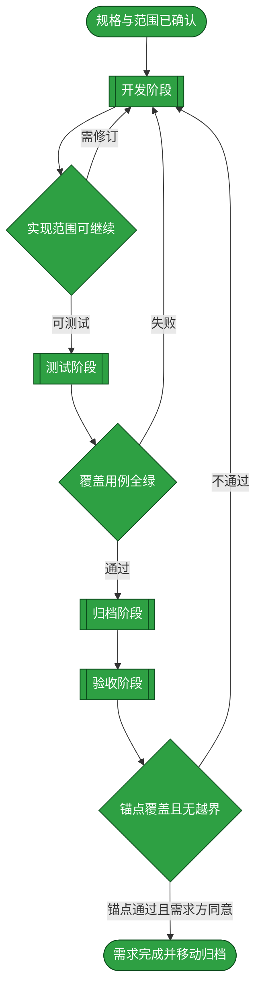
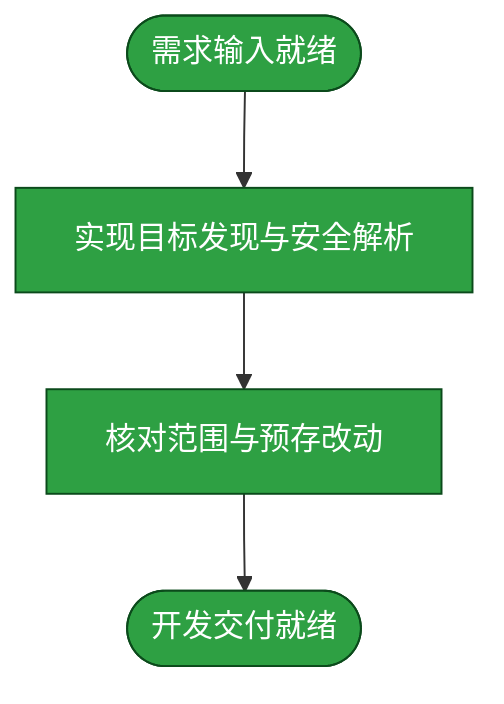
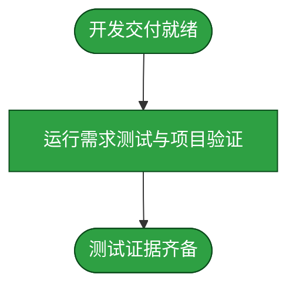
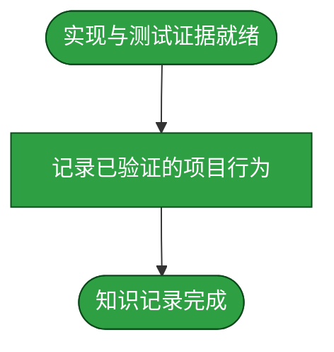
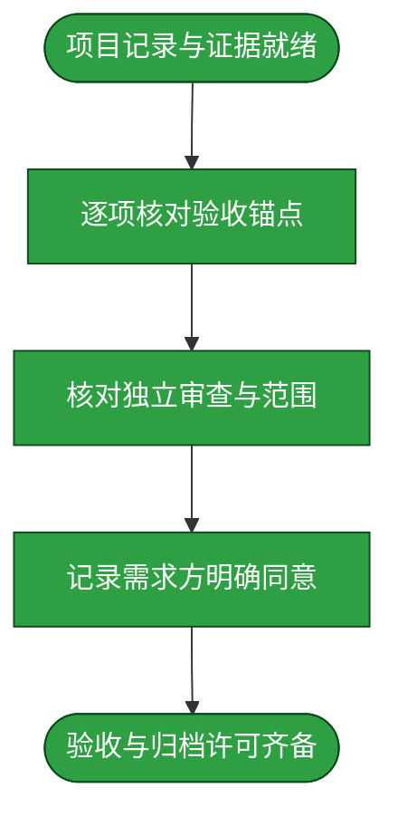

# 需求：SSH agent 按配置发现并安全解析目标别名

```yaml
target: assets/projects/dsh-credentials/
output: assets/projects/dsh-credentials/
prompt:
  - dsh-credentials插件agent在使用是还是会每次请求输入昵称，需要让agent在需要ssh连接的时候，先获取当前配置的ssh昵称列表，然后找到合适的。同时，也应该需要支持模糊匹配以及多昵称支持，比如说到nas,unraid,theworld都应该能指向unraid这条ssh凭证
  - 重新加载领域dsh-credentials,进行上述需求开发
```

本需求使 agent 在处理 SSH 目标时能先查看当前配置的目标标识，再依靠明确配置的多个昵称解析到同一 canonical SSH 目标，避免每次向用户重新索取昵称；流程只在唯一可信的结果上解析，不确定的近似结果与冲突交还用户选择，且不发起连接。

## 需求澄清

### 澄清记录

- 问答：对“模糊匹配”的处理，是否允许只把近似匹配作为候选而不自动选择？ → 按建议实施：别名/昵称归一化后精确匹配；模糊候选仅供参考；多个候选或只有模糊命中时不自动选择或连接。
  - 裁决：显式昵称是将常用说法映射到 canonical alias 的权威机制；模糊算法只帮助消歧，不授予连接身份。
  - 反论与代价：严格拒绝不确定查询可能要求用户多一次确认；相反自动选“最像”的目标可能把 SSH 命令导向错误主机，影响面是用户数据与远程系统。放弃自动模糊选择，代价是少量人工澄清。
  - 验收面：nas/unraid/theworld 等配置为同一目标的 nickname 时均解析为 canonical alias unraid；歧义和模糊候选返回候选并拒绝解析。
- 问答：项目仓库与知识库记录分别使用哪个分支？ → 知识库根在 duoduo，dsh-credentials 源码仓库在 main。
  - 裁决：需求记录留在知识库 duoduo；项目实现只在已确认的项目 main 分支上进行，不切换分支。
  - 反论与代价：项目工作区已有未提交改动，叠加实现会增加审阅复杂度；但清理或覆盖它们会有不可逆丢失风险。保留所有既有改动，只编辑本需求所需的代码和测试。
  - 验收面：改动前后均确认项目在 main；最终 diff 可明确区分新增需求改动与预存变更，不撤销或格式化预存改动。

### 验收锚点

- A1：agent 可在解析 SSH 引用前读取当前已配置目标列表；列举操作不探测或连接主机。
- A2：一个 canonical target 可保存并列出多个昵称，旧的单 nickname 配置仍可读取和写回。
- A3：alias 优先；昵称经大小写/空白归一化后唯一匹配时返回 canonical alias。
- A4：仅模糊匹配或存在多个候选时明确返回候选并拒绝解析，不触发连接。
- A5：项目测试 README 所规定的测试运行完整通过且无跳过。

### 范围边界

- 不做：自动 SSH 连接、网络探测、凭据或私钥内容读取/暴露。
- 不做：静默重命名既有目标或自动推断用户昵称。
- 不做：清理、回滚、提交或格式化项目工作区已有的未提交改动。

## 主流程图



## START

开始前确认规格、分支与既有工作区保护要求；本需求的输入信息与澄清裁决已就位，输出为交给开发阶段的需求规格。

**输入**

- `PROMPT`：用户提出的功能与分支要求；来源为本文前置数据块。

**输出**

- `REQ_SPEC`：已确认功能规格；去向为 `DEVELOP`。
- `CLARIFICATIONS`：需求澄清裁决、验收锚点与范围边界；去向为 `DEVELOP`。

## DEVELOP

开发阶段在已确认的 dsh-credentials 项目 main 分支实现目标列表发现、多昵称兼容与安全解析，只改本需求所需代码与测试，保留既有工作区内容；本阶段由独立开发者按下列子流程形成可供测试的改动。返工时沿用 `START` 生成且由 `REWORK_BRIEF` 保留的原澄清上下文，不重新解释或丢弃既定验收锚点。

**输入**

- `REQ_SPEC`：已确认功能规格；来源为 `START`。
- `CLARIFICATIONS`：需求澄清裁决、验收锚点与范围边界；来源为 `START`、`DEV_GATE`、`TEST_GATE` 或 `ACCEPT_GATE`。
- `DEV_RESULT`：实现差异与改动清单；来源为 `D_DONE`。
- `REWORK_BRIEF`：门禁缺陷、原澄清上下文与需修订范围；来源为 `DEV_GATE`、`TEST_GATE` 或 `ACCEPT_GATE`。

**输出**

- `REQ_SPEC`：已确认功能规格；去向为 `D_START`。
- `REWORK_BRIEF`：门禁缺陷、原澄清上下文与需修订范围；去向为 `D_START`。
- `DEV_RESULT`：实现差异与改动清单；去向为 `DEV_GATE`。
- `CLARIFICATIONS`：需求澄清裁决、验收锚点与范围边界；去向为 `D_START`、`DEV_GATE`。



### D_START

本节点将已确认规格、验收锚点、范围边界及必要返工信息交给开发者，作为实现约束。

**输入**

- `REQ_SPEC`：已确认功能规格；来源为 `DEVELOP`。
- `CLARIFICATIONS`：需求澄清裁决、验收锚点与范围边界；来源为 `DEVELOP`。
- `REWORK_BRIEF`：门禁缺陷、原澄清上下文与需修订范围；来源为 `DEVELOP`。

**输出**

- `DEV_BRIEF`：开发作业书；去向为 `D_EDIT`。
- `CLARIFICATIONS`：需求澄清裁决、验收锚点与范围边界；去向为 `D_EDIT`。

### D_EDIT

独立开发者按作业书实施目标列表发现、多昵称配置兼容、昵称解析与安全失败响应，不执行 SSH 连接或网络探测。

**输入**

- `DEV_BRIEF`：开发作业书；来源为 `D_START`。
- `CLARIFICATIONS`：需求澄清裁决、验收锚点与范围边界；来源为 `D_START`。

**输出**

- `CLARIFICATIONS`：需求澄清裁决、验收锚点与范围边界；去向为 `D_REVIEW`。
- `IMPLEMENTATION`：本需求实现差异；去向为 `D_REVIEW`。

### D_REVIEW

核对实现只触及本需求范围，且项目 main 分支上既有未提交改动未被清理、回滚或格式化；形成改动清单与实现说明。

**输入**

- `IMPLEMENTATION`：本需求实现差异；来源为 `D_EDIT`。
- `CLARIFICATIONS`：需求澄清裁决、验收锚点与范围边界；来源为 `D_EDIT`。

**输出**

- `CLARIFICATIONS`：需求澄清裁决、验收锚点与范围边界；去向为 `D_DONE`。
- `DEV_RESULT`：实现差异与改动清单；去向为 `D_DONE`。

### D_DONE

开发子流程以可供独立测试的实现交付结束。

**输入**

- `CLARIFICATIONS`：需求澄清裁决、验收锚点与范围边界；来源为 `D_REVIEW`。
- `DEV_RESULT`：实现差异与改动清单；来源为 `D_REVIEW`。

**输出**

- `CLARIFICATIONS`：需求澄清裁决、验收锚点与范围边界；去向为 `DEVELOP`。
- `DEV_RESULT`：实现差异与改动清单；去向为 `DEVELOP`。

## DEV_GATE

核对开发交付是否仍在项目源码与必要测试范围内，且既有工作区改动保持原状；符合范围时进入测试，存在冲突或必须扩大范围时先向需求方澄清，再将已确认的修订要求交回开发阶段。

**输入**

- `DEV_RESULT`：实现差异与改动清单；来源为 `DEVELOP`。
- `CLARIFICATIONS`：需求澄清裁决、验收锚点与范围边界；来源为 `DEVELOP`。

**输出**

- `DEV_RESULT`：实现差异与改动清单；去向为 `TEST`。
- `CLARIFICATIONS`：需求澄清裁决、验收锚点与范围边界；去向为 `TEST`、`DEVELOP`。
- `REWORK_BRIEF`：门禁缺陷、原澄清上下文与需修订范围；去向为 `DEVELOP`。

## TEST

测试阶段由独立测试者补充覆盖昵称解析、旧配置兼容、列表工具、alias 优先级、模糊候选拒绝与歧义拒绝的用例；测试者不修改产品代码，失败则回到开发阶段。项目静态测试命令与判据取[项目测试说明](../projects/dsh-credentials/tests/README.md)；本次历史验证另运行 `DSH_PLUGIN_LOADER=/mnt/deepseek-harness/plugin-loader npm test`、`DSH_PLUGIN_LOADER=/mnt/deepseek-harness/plugin-loader npm run build`、`DSH_PLUGIN_LOADER=/mnt/deepseek-harness/plugin-loader npm run build:cordis`、`node tests/live-mount-probe.mjs` 与 `DSH_PLUGIN_LOADER=/mnt/deepseek-harness/plugin-loader npm run check:artifacts`，均记录为退出码零。

**输入**

- `DEV_RESULT`：实现差异与改动清单；来源为 `DEV_GATE`。
- `CLARIFICATIONS`：需求澄清裁决、验收锚点与范围边界；来源为 `DEV_GATE`。
- `TEST_EVIDENCE`：测试运行结果与证据；来源为 `T_DONE`。

**输出**

- `DEV_RESULT`：实现差异与改动清单；去向为 `TEST_GATE`。
- `TEST_EVIDENCE`：测试运行结果与证据；去向为 `TEST_GATE`。
- `CLARIFICATIONS`：需求澄清裁决、验收锚点与范围边界；去向为 `TEST_GATE`。



### T_START

本节点将开发交付与验收要求交给独立测试者，界定测试对象与行为边界。

**输入**

- `DEV_RESULT`：实现差异与改动清单；来源为 `TEST`。
- `CLARIFICATIONS`：需求澄清裁决、验收锚点与范围边界；来源为 `TEST`。

**输出**

- `TEST_SCOPE`：测试对象与行为要求；去向为 `T_RUN`。
- `DEV_RESULT`：实现差异与改动清单；去向为 `T_RUN`。
- `CLARIFICATIONS`：需求澄清裁决、验收锚点与范围边界；去向为 `T_RUN`。

### T_RUN

独立测试者补充需求行为用例，并按项目测试说明运行完整套件；失败用例保留为证据，不由测试阶段绕过或修改产品代码。

**输入**

- `TEST_SCOPE`：测试对象与行为要求；来源为 `T_START`。
- `DEV_RESULT`：实现差异与改动清单；来源为 `T_START`。
- `CLARIFICATIONS`：需求澄清裁决、验收锚点与范围边界；来源为 `T_START`。

**输出**

- `DEV_RESULT`：实现差异与改动清单；去向为 `T_DONE`。
- `CLARIFICATIONS`：需求澄清裁决、验收锚点与范围边界；去向为 `T_DONE`。
- `TEST_EVIDENCE`：测试运行结果与证据；去向为 `T_DONE`。

### T_DONE

将完整测试结果交给测试门禁判定；通过要求为所有要求用例全绿、无跳过且退出码为零。

**输入**

- `DEV_RESULT`：实现差异与改动清单；来源为 `T_RUN`。
- `CLARIFICATIONS`：需求澄清裁决、验收锚点与范围边界；来源为 `T_RUN`。
- `TEST_EVIDENCE`：测试运行结果与证据；来源为 `T_RUN`。

**输出**

- `DEV_RESULT`：实现差异与改动清单；去向为 `TEST`。
- `CLARIFICATIONS`：需求澄清裁决、验收锚点与范围边界；去向为 `TEST`。
- `TEST_EVIDENCE`：测试运行结果与证据；去向为 `TEST`。

## TEST_GATE

只有要求测试全部通过、没有跳过且未放宽断言时进入归档；其他结果连同失败证据交回开发阶段修复。

**输入**

- `DEV_RESULT`：实现差异与改动清单；来源为 `TEST`。
- `TEST_EVIDENCE`：测试运行结果与证据；来源为 `TEST`。
- `CLARIFICATIONS`：需求澄清裁决、验收锚点与范围边界；来源为 `TEST`。

**输出**

- `DEV_RESULT`：实现差异与改动清单；去向为 `ARCHIVE`。
- `TEST_EVIDENCE`：测试运行结果与证据；去向为 `ARCHIVE`。
- `CLARIFICATIONS`：需求澄清裁决、验收锚点与范围边界；去向为 `ARCHIVE`、`DEVELOP`。
- `REWORK_BRIEF`：门禁缺陷、原澄清上下文与需修订范围；去向为 `DEVELOP`。

## ARCHIVE

归档阶段将经测试证实的行为记录在[项目 README](../projects/dsh-credentials/README.md)的「Agent 按昵称解析目标」小节，确认领域知识与实现、测试证据一致；独立记录者不得复制项目源码或改写测试结果。

**输入**

- `DEV_RESULT`：实现差异与改动清单；来源为 `TEST_GATE`。
- `TEST_EVIDENCE`：测试运行结果与证据；来源为 `TEST_GATE`。
- `CLARIFICATIONS`：需求澄清裁决、验收锚点与范围边界；来源为 `TEST_GATE`。
- `ARCHIVE_RESULT`：已验证项目行为记录与未验证面；来源为 `A_DONE`。

**输出**

- `ARCHIVE_RESULT`：已验证项目行为记录与未验证面；去向为 `ACCEPT`。
- `DEV_RESULT`：实现差异与改动清单；去向为 `ACCEPT`。
- `TEST_EVIDENCE`：测试运行结果与证据；去向为 `ACCEPT`。
- `CLARIFICATIONS`：需求澄清裁决、验收锚点与范围边界；去向为 `ACCEPT`。



### A_START

本节点接收实现与测试证据，界定项目 README 所需记录的已验证行为。

**输入**

- `DEV_RESULT`：实现差异与改动清单；来源为 `ARCHIVE`。
- `TEST_EVIDENCE`：测试运行结果与证据；来源为 `ARCHIVE`。
- `CLARIFICATIONS`：需求澄清裁决、验收锚点与范围边界；来源为 `ARCHIVE`。

**输出**

- `RECORD_INPUT`：经测试证实的行为与边界；去向为 `A_RECORD`。
- `DEV_RESULT`：实现差异与改动清单；去向为 `A_RECORD`。
- `TEST_EVIDENCE`：测试运行结果与证据；去向为 `A_RECORD`。
- `CLARIFICATIONS`：需求澄清裁决、验收锚点与范围边界；去向为 `A_RECORD`。

### A_RECORD

记录目标发现、多个 nickname 与旧配置兼容、alias 优先、安全拒绝不确定候选，以及工具只读且不连接主机的约定。

**输入**

- `RECORD_INPUT`：经测试证实的行为与边界；来源为 `A_START`。
- `DEV_RESULT`：实现差异与改动清单；来源为 `A_START`。
- `TEST_EVIDENCE`：测试运行结果与证据；来源为 `A_START`。
- `CLARIFICATIONS`：需求澄清裁决、验收锚点与范围边界；来源为 `A_START`。

**输出**

- `DEV_RESULT`：实现差异与改动清单；去向为 `A_DONE`。
- `TEST_EVIDENCE`：测试运行结果与证据；去向为 `A_DONE`。
- `CLARIFICATIONS`：需求澄清裁决、验收锚点与范围边界；去向为 `A_DONE`。
- `KNOWLEDGE_RECORD`：项目 README 中的行为记录；去向为 `A_DONE`。

### A_DONE

项目行为记录与已验证实现一致；真实 Cordis host 展示效果及 SSH 连接未验证，也不属于本需求承诺的证据面。

**输入**

- `DEV_RESULT`：实现差异与改动清单；来源为 `A_RECORD`。
- `TEST_EVIDENCE`：测试运行结果与证据；来源为 `A_RECORD`。
- `CLARIFICATIONS`：需求澄清裁决、验收锚点与范围边界；来源为 `A_RECORD`。
- `KNOWLEDGE_RECORD`：项目 README 中的行为记录；来源为 `A_RECORD`。

**输出**

- `ARCHIVE_RESULT`：已验证项目行为记录与未验证面；去向为 `ARCHIVE`。
- `DEV_RESULT`：实现差异与改动清单；去向为 `ARCHIVE`。
- `TEST_EVIDENCE`：测试运行结果与证据；去向为 `ARCHIVE`。
- `CLARIFICATIONS`：需求澄清裁决、验收锚点与范围边界；去向为 `ARCHIVE`。

## ACCEPT

验收阶段按 A1–A5 对照实现、测试与独立审查证据，不把未承诺的真实 Cordis host 展示效果或 SSH 连接作为通过条件；验收结果只有在需求方明确同意后才可归档。

**输入**

- `ARCHIVE_RESULT`：已验证项目行为记录与未验证面；来源为 `ARCHIVE`。
- `DEV_RESULT`：实现差异与改动清单；来源为 `ARCHIVE`。
- `TEST_EVIDENCE`：测试运行结果与证据；来源为 `ARCHIVE`。
- `CLARIFICATIONS`：需求澄清裁决、验收锚点与范围边界；来源为 `ARCHIVE`。
- `ACCEPTANCE_EVIDENCE`：验收结论与需求方明确归档许可；来源为 `Q_DONE`。

**输出**

- `ARCHIVE_RESULT`：已验证项目行为记录与未验证面；去向为 `Q_START`。
- `DEV_RESULT`：实现差异与改动清单；去向为 `Q_START`。
- `TEST_EVIDENCE`：测试运行结果与证据；去向为 `Q_START`。
- `ACCEPTANCE_EVIDENCE`：验收结论与需求方明确归档许可；去向为 `ACCEPT_GATE`。
- `CLARIFICATIONS`：需求澄清裁决、验收锚点与范围边界；去向为 `Q_START`、`ACCEPT_GATE`。



### Q_START

本节点接收实现差异、项目行为记录与测试证据，作为逐项验收的共同材料。

**输入**

- `ARCHIVE_RESULT`：已验证项目行为记录与未验证面；来源为 `ACCEPT`。
- `DEV_RESULT`：实现差异与改动清单；来源为 `ACCEPT`。
- `TEST_EVIDENCE`：测试运行结果与证据；来源为 `ACCEPT`。
- `CLARIFICATIONS`：需求澄清裁决、验收锚点与范围边界；来源为 `ACCEPT`。

**输出**

- `ACCEPT_INPUT`：待核对的记录与证据；去向为 `Q_CHECK`。
- `CLARIFICATIONS`：需求澄清裁决、验收锚点与范围边界；去向为 `Q_CHECK`。

### Q_CHECK

按验收锚点逐项核对目标列表、昵称兼容、alias 优先、拒绝模糊与歧义候选，以及项目测试结果。

**输入**

- `ACCEPT_INPUT`：待核对的记录与证据；来源为 `Q_START`。
- `CLARIFICATIONS`：需求澄清裁决、验收锚点与范围边界；来源为 `Q_START`。

**输出**

- `REVIEW_INPUT`：锚点核对结果；去向为 `Q_REVIEW`。
- `CLARIFICATIONS`：需求澄清裁决、验收锚点与范围边界；去向为 `Q_REVIEW`。

### Q_REVIEW

独立领域审查确认列表内容、别名解析、多昵称兼容、安全失败响应及设置页行为；第二次审查将“target nickname 字段”误读成独立插件配置项，故协调者再以两形态 `register()` 调用链、Cordis adapter 调用点、bundle live probe 和项目测试输出复核。审查未验证真实 Cordis host 展示效果，也未执行 SSH 连接。

**输入**

- `REVIEW_INPUT`：验收锚点核对结果；来源为 `Q_CHECK`。
- `CLARIFICATIONS`：需求澄清裁决、验收锚点与范围边界；来源为 `Q_CHECK`。

**输出**

- `REVIEW_EVIDENCE`：独立审查与协调者复核记录；去向为 `Q_APPROVAL`。
- `CLARIFICATIONS`：需求澄清裁决、验收锚点与范围边界；去向为 `Q_APPROVAL`。

### Q_APPROVAL

需求方明确回复「同意归档」；该回复确认本需求验收结果可进入归档，不扩大原需求范围。

**输入**

- `REVIEW_EVIDENCE`：独立审查与协调者复核记录；来源为 `Q_REVIEW`。
- `REQUESTER_REPLY`：需求方明确归档决定；来源为流程外部的需求方回复。
- `CLARIFICATIONS`：需求澄清裁决、验收锚点与范围边界；来源为 `Q_REVIEW`。

**输出**

- `ACCEPTANCE_EVIDENCE`：验收结论与需求方明确归档许可；去向为 `Q_DONE`。
- `CLARIFICATIONS`：需求澄清裁决、验收锚点与范围边界；去向为 `Q_DONE`。

### Q_DONE

验收证据与需求方许可齐备后，将验收结论交给验收阶段出口。

**输入**

- `ACCEPTANCE_EVIDENCE`：验收结论与需求方明确归档许可；来源为 `Q_APPROVAL`。
- `CLARIFICATIONS`：需求澄清裁决、验收锚点与范围边界；来源为 `Q_APPROVAL`。

**输出**

- `ACCEPTANCE_EVIDENCE`：验收结论与需求方明确归档许可；去向为 `ACCEPT`。
- `CLARIFICATIONS`：需求澄清裁决、验收锚点与范围边界；去向为 `ACCEPT`。

## ACCEPT_GATE

核对 A1–A5 均由相应实现、测试或审查证据支持，列表与解析不触发连接，且预存工作区未被清理或回滚；全部满足并已取得需求方明确同意时完成，否则将缺口交回开发阶段。

**输入**

- `ACCEPTANCE_EVIDENCE`：验收结论与需求方明确归档许可；来源为 `ACCEPT`。
- `CLARIFICATIONS`：需求澄清裁决、验收锚点与范围边界；来源为 `ACCEPT`。

**输出**

- `ACCEPTANCE_EVIDENCE`：验收结论与需求方明确归档许可；去向为 `DONE`。
- `REWORK_BRIEF`：门禁缺陷、原澄清上下文与需修订范围；去向为 `DEVELOP`。
- `CLARIFICATIONS`：需求澄清裁决、验收锚点与范围边界；去向为 `DEVELOP`。

## DONE

所有完成路径节点均已执行并标绿；按[归档规则](../../assets/archive/README.md)，将本文整篇移动到归档目录并保持文件名不变，移动后停止修改。

**输入**

- `ACCEPTANCE_EVIDENCE`：验收结论与需求方明确归档许可；来源为 `ACCEPT_GATE`。

**输出**

- `ARCHIVE_MOVE`：整篇文档移至 `assets/archive/`；去向为流程外部的归档操作。
