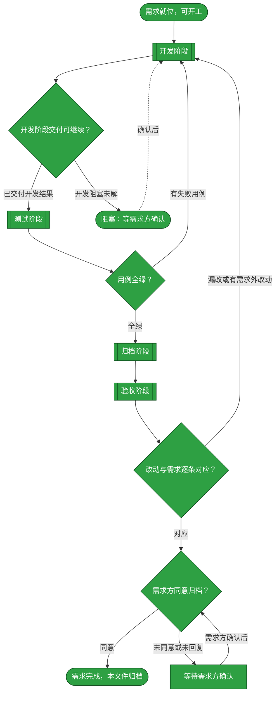
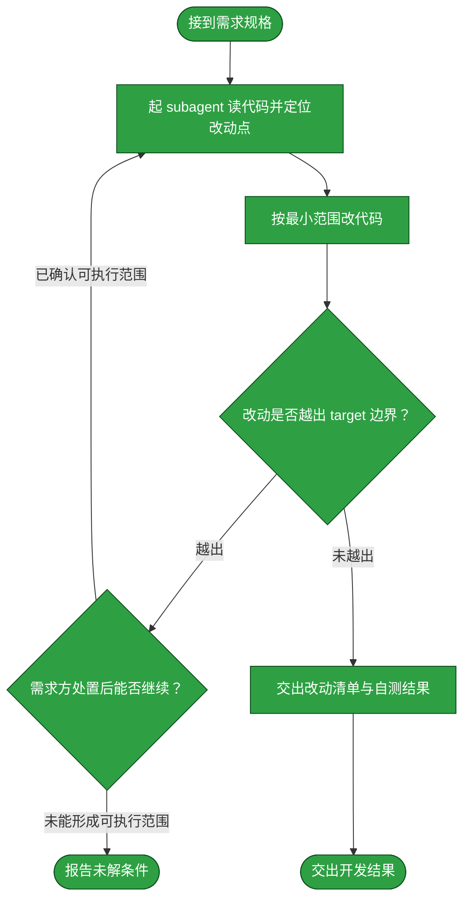
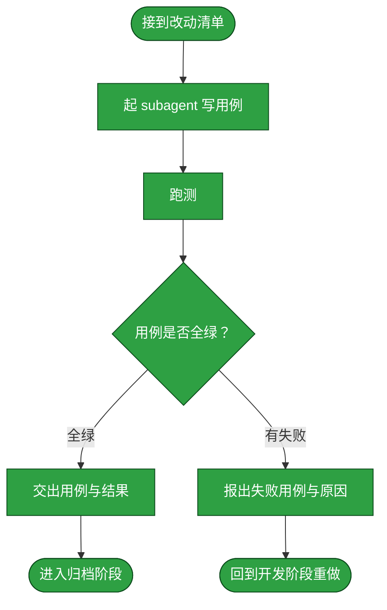
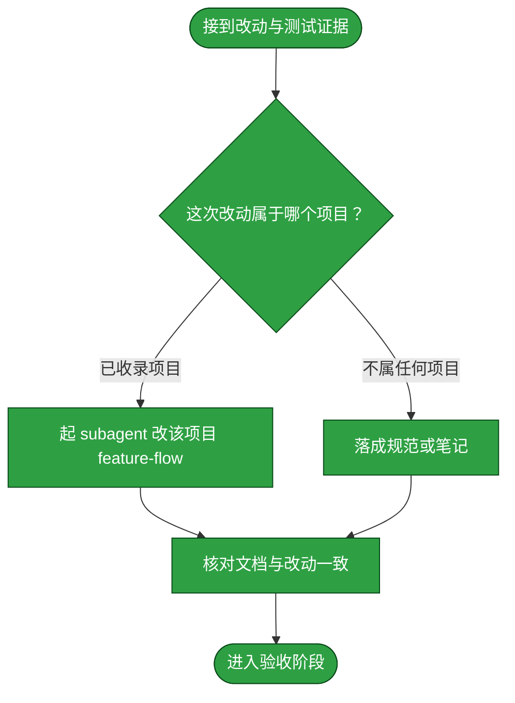
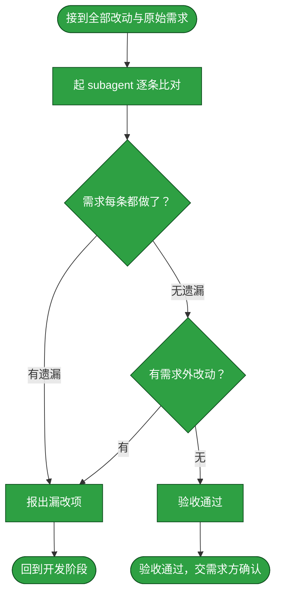

# 需求：缓存媒体库 META 数据，避免资源刷新反复读取 NAS

```yaml
target: assets/projects/home-media-pilot/home-media-pilot/
output: assets/projects/home-media-pilot/home-media-pilot/
prompt:
  - 需要优化HMP，缓存刷新媒体库的META数据，这样不用每次刷新都要去nas获取。
  - 图片也是META的一部分
```

本需求从 HMP 资源清单读取 META 的流程开始，到媒体库扫描更新持久化 META 缓存、普通资源列表与图片请求从缓存返回数据而不再访问 NAS sidecar 为止。缓存包含 NFO 解析值及 NAS 本地海报图像本体；Provider 远端海报仍按原 URL 使用。

## 需求澄清

### 澄清记录

- 问答：你说的“刷新媒体库 META 数据”希望采用哪种策略？→“持久缓存 + 显式重建（推荐）”：写入 HMP 数据库；普通列表不访问 NAS，显式刷新或媒体库重新扫描时读取 NAS 并更新缓存。
  - 裁决：选择数据库持久缓存，资源列表读取缓存，媒体库扫描作为更新该缓存的触发点；不另建独立 META 刷新入口。
  - 反论与代价：只在重新扫描时更新，NAS sidecar 发生变化后缓存会保留旧值直到下一次扫描；独立刷新入口虽及时但增加操作与接口复杂度。验收面是扫描后缓存更新，扫描之间重复读取资源清单不访问 NAS 的 sidecar。
  - 被消歧的措辞：缓存持久性及缓存重建触发时机。
- 问答：缓存如何显式重建？→“复用重新扫描”：每次扫描同时重建 META 缓存，不额外增加操作入口。
  - 裁决：扫描执行时更新媒体库 META 缓存；普通资源列表的页面刷新不触发扫描，也不读 NAS sidecar。
  - 反论与代价：若扫描本身频繁运行仍会访问 NAS；但扫描是明确的数据更新动作，避免另设缓存刷新接口与双重失效语义。验收面为扫描前后 sidecar 变更可反映到缓存，而仅请求资源清单不重新读取 sidecar。
  - 被消歧的措辞：更新入口及 NAS 内容变更后缓存何时刷新。
- 问答：Provider 返回的远端 `poster_url` 图片也要下载并缓存吗？→“只缓存 NAS 本地海报（推荐）”。
  - 裁决：NFO 解析值保存在数据库，NAS 本地封面图像字节保存在部署持久数据卷 `/app/data` 的文件缓存，`MediaFile` 记录缓存标识；普通列表与图片路由都从缓存取值。每次扫描替换海报缓存，发现 sidecar 缺失时清除对应缓存；Provider 远端 `poster_url` 保持原 URL，不下载缓存。文件缓存可独立于 SQLite 数据库增长与重建，避免将大量图像 BLOB 塞入权威业务库；该设计不改变媒体索引实体的删除语义。
  - 反论与代价：文件缓存避免把每张图片作为 DB BLOB 膨胀数据库，但会占用持久数据卷空间；侧车变化在下一次扫描前仍可能短暂显示旧图。证伪条件是完成扫描后海报接口仍返回旧图、找不到新图，或海报接口仍访问 NAS；弃用文件缓存需要迁移已存缓存键并清理文件，维护成本落在 HMP 数据存储层。
  - 被消歧的措辞：图片是否属于 META 缓存，以及缓存哪些来源的图片。
- 问答：图片缓存备份与恢复策略应如何选择？→“缓存可重建（推荐）”。
  - 裁决：poster-cache 是由 NAS sidecar 派生的非权威文件，不要求纳入数据库备份；恢复数据库但缺少缓存文件时，海报接口安全返回未找到且不回退读取 NAS，运维需在 NAS 可用时重新扫描重建。
  - 反论与代价：仅恢复数据库后，本地海报会暂时缺失直到重新扫描；优点是备份不重复保存可再生的海报图像，降低容量与数据库/文件缓存快照必须原子一致的要求。证伪条件是缺失缓存时 API 仍提供 NAS 文件、错误读取任意路径，或重扫后不能恢复图像；弃用此策略需让备份纳入数据库与图像文件的一致快照，责任落在部署运维与缓存实现维护者。
  - 被消歧的措辞：持久缓存文件是否属于备份必备数据，以及恢复后的缓存缺失行为。

### 验收锚点

- A1：扫描发现或更新 META 后，结果存入持久存储，进程重启后仍可取回。
- A2：扫描之间重复请求资源清单时，META 由持久缓存提供，列表路径不读取 NAS sidecar。
- A3：NAS sidecar 经扫描更新或移除后，缓存能反映更新/移除，不继续展示陈旧值。
- A4：已有 Provider 元数据与 NFO/本地封面优先级及资源清单既有行为不被破坏。
- A5：扫描将 NAS 本地海报图像本体写入持久缓存；之后图片路由从缓存返回相同图片字节，不再读取 NAS；重扫会替换或清除对应图像缓存。Provider 远端 poster 图片保持原 URL，不下载缓存。
- A6：只恢复数据库而不恢复 poster-cache 文件时，图片路由安全返回未找到、不回退访问 NAS；重新扫描后能重建缓存并恢复图片响应。

### 范围边界

- 不做：新增独立 META 刷新按钮/API；下载缓存 Provider poster_url 或 NFO thumb 等远端图像 URL；改变 Provider 元数据匹配、候选存储或媒体文件扫描语义；缓存视频/音频媒体内容。

## 主流程图



## START

开工前的就位判定：需求已在前置块里写清 `target` 与 `output`，这两项都是具体路径而非占位符，且「需求澄清」章节的验收锚点与范围边界已就位（无澄清需要时该节显式写「无」并给出理由）。本节点不出分支。

**输入**

- `REQ_READY`：前置块三键已填、澄清章节已就位的状态；来源为本文件的前置数据块与「需求澄清」章节。

**输出**

- `REQ_SPEC`：本需求的规格，即前置块的三键内容；去向为 `DEVELOP`。
- `CLARIFICATIONS`：澄清裁决与验收锚点；去向为 `DEVELOP`。

## DEVELOP

开发阶段。本阶段的产出是**功能改动本身**——不产出测试，也不落档。它按下面的子流程走。

**起独立 subagent**：本阶段由一个新起的 subagent 执行，不承接对话里的上下文。交给它的输入是 `REQ_SPEC`（前置块三键）与 `CLARIFICATIONS`（「需求澄清」章节的裁决与验收锚点），再加本节写明的边界；它在自己的上下文里读代码、改代码、把改动落到工作区，中间过程留在它那里。

**边界**：它只改 `target` 指到的内容，不改需求未提及的相邻模块；发现必须改动需求之外的代码时停下并报出，不自行扩大范围。

**项目仓库分支策略**：当 `target` 指向 `assets/projects/<项目>/<repository>/` 时，先确认该仓库当前分支是 `main`，并在 `main` 上开发、测试和验证；不为需求创建专用分支，也不安排需求分支的合并或删除。若仓库不在 `main`，或需求要求多人协作而此规则不适用，先暂停并向需求方确认，不自行切换或重置分支。

**输入**

- `REQ_SPEC`：本需求的规格；来源为 `START`。
- `CLARIFICATIONS`：需求澄清章节的裁决与验收锚点；来源为本文件的「需求澄清」章节。
- `FAILURE_REPORT`：失败用例与原因；来源为 `T_BACK`。
- `ACCEPT_FAILURE`：漏改或多余的处置要求；来源为 `C_OUT`。
- `DEV_RESOLVED`：开发阻塞已排除；来源为 `BLOCKED`。
- `DEV_RESULT`：开发子流程交付的改动清单与自测结果；来源为 `D_OUT`。
- `OPEN_QUESTION`：开发子流程交付的未解条件；来源为 `D_FAIL`。
- `TEST_VERDICT`：全绿与否；来源为 `TEST_GATE`。
- `ACCEPT_VERDICT`：逐条对应与否；来源为 `ACCEPT_GATE`。

**输出**

- `REQ_SPEC`：本轮需求规格；去向为 `D_IN`。
- `CLARIFICATIONS`：澄清裁决与验收锚点；去向为 `D_IN`。
- `FAILURE_REPORT`：上一轮失败用例与原因（若本轮由测试失败返回）；去向为 `D_IN`。
- `ACCEPT_FAILURE`：验收发现的漏改或范围外改动（若本轮由验收退回）；去向为 `D_IN`。
- `DEV_RESOLVED`：已解除的开发阻塞（若本轮由阻塞返回）；去向为 `D_IN`。
- `TEST_VERDICT`：上一轮测试判定（若有）；去向为 `D_IN`。
- `ACCEPT_VERDICT`：上一轮验收判定（若有）；去向为 `D_IN`。
- `DEV_RESULT`：改动清单与自测结果；去向为 `DEV_GATE`。
- `OPEN_QUESTION`：悬置的条件；去向为 `DEV_GATE`。



### D_IN

承接父级 `DEVELOP` 分发的本轮需求、上一轮反馈与阻塞解决结果，把它们整理成交给 subagent 的作业书。本节点不出分支。

**输入**

- `REQ_SPEC`：本轮需求规格；来源为 `DEVELOP`。
- `CLARIFICATIONS`：澄清裁决与验收锚点；来源为 `DEVELOP`。
- `FAILURE_REPORT`：上一轮失败用例与原因（若本轮由测试失败返回）；来源为 `DEVELOP`。
- `ACCEPT_FAILURE`：验收发现的漏改或范围外改动（若本轮由验收退回）；来源为 `DEVELOP`。
- `DEV_RESOLVED`：已解除的开发阻塞（若本轮由阻塞返回）；来源为 `DEVELOP`。
- `TEST_VERDICT`：上一轮测试判定（若有）；来源为 `DEVELOP`。
- `ACCEPT_VERDICT`：上一轮验收判定（若有）；来源为 `DEVELOP`。

**输出**

- `DEV_BRIEF`：作业书，含 `REQ_SPEC`、`CLARIFICATIONS`、`FAILURE_REPORT`、`ACCEPT_FAILURE`、`DEV_RESOLVED`、`TEST_VERDICT`、`ACCEPT_VERDICT`（有对应来源时附带）、范围边界及项目仓库分支策略；去向为 `D_AGENT`。

### D_AGENT

起一个独立 subagent，把 `DEV_BRIEF` 交给它，由它读代码并定位本需求要改的那一处。**为什么独立**：开发要在自己的上下文里反复读文件、试错、回退，这些中间过程对本流程其余阶段是噪声；独立 subagent 让它们留在自己的上下文里，本流程只收它的结论。

**输入**

- `DEV_BRIEF`：作业书；来源为 `D_IN`。
- `SCOPE_RESOLVED`：已确认的边界；来源为 `D_STOP`。

**输出**

- `CHANGE_POINT`：改动点，即要改的文件与位置；去向为 `D_EDIT`。

### D_EDIT

按最小范围实施改动。**最小范围**指只改需求要求的那一处行为，不顺手重构、不改格式、不升级依赖。

**输入**

- `CHANGE_POINT`：改动点；来源为 `D_AGENT`。

**输出**

- `DIFF`：本次改动；去向为 `D_SCOPE`。

### D_SCOPE

判定改动是否越出 `target` 边界。判定语义是：`DIFF` 触及的每个文件，是否都落在 `target` 所指的范围内。越界不一定是错的，但**必须报出来由需求方确认**，因为它意味着这条需求的实际影响面比它写下的 `target` 更大。

**输入**

- `DIFF`：本次改动；来源为 `D_EDIT`。

**输出**

- `SCOPE_VERDICT`：越界与否及其具体落点；去向为 `D_STOP` 或 `D_REPORT`。

### D_STOP

越界出口：把范围差异交给需求方确认；明确确认可执行的新范围或收回越界改动后回到开发，无法形成可执行范围时报告未解条件。

**输入**

- `SCOPE_VERDICT`：越界点；来源为 `D_SCOPE`。
- `SCOPE_REPLY`：需求方对越界的处置；来源为流程外部的确认动作。

**输出**

- `SCOPE_RESOLVED`：已确认的可执行边界；去向为 `D_AGENT`。
- `OPEN_QUESTION`：无法继续的未解条件；去向为 `D_FAIL`。

### D_FAIL

开发子流程阻塞出口：报告无法继续的条件，并把它交给父级 `DEVELOP` 做出口判定。

**输入**

- `OPEN_QUESTION`：无法继续的未解条件；来源为 `D_STOP`。

**输出**

- `OPEN_QUESTION`：开发阻塞条件；去向为 `DEVELOP`。

### D_REPORT

交出改动清单与开发自测结果，作为开发出口判定的输入。**开发自测不等于测试阶段**：这里只证明改动跑得起来，覆盖需求要求的行为由测试阶段负责。

**输入**

- `DIFF`：本次改动；来源为 `D_EDIT`。
- `SCOPE_VERDICT`：未越界的判定；来源为 `D_SCOPE`。

**输出**

- `DEV_RESULT`：改动清单与自测结果；去向为 `D_OUT`。

### D_OUT

开发子流程成功出口：改动已在工作区就位且未越界；将开发结果交给父级 `DEVELOP` 做出口判定。

**输入**

- `DEV_RESULT`：改动清单与自测结果；来源为 `D_REPORT`。

**输出**

- `DEV_RESULT`：改动清单与自测结果；去向为 `DEVELOP`。

## DEV_GATE

开发出口判定：只有 `DEV_RESULT` 完整且不存在未解条件时进入测试；其余状态整理为 `OPEN_QUESTION` 并转入阻塞等待。

**输入**

- `DEV_RESULT`：改动清单与自测结果；来源为 `DEVELOP`。
- `OPEN_QUESTION`：开发子流程未解的条件；来源为 `DEVELOP`。

**输出**

- `DEV_RESULT`：可测试的开发结果；去向为 `TEST`、`ARCHIVE`、`ACCEPT`。
- `OPEN_QUESTION`：阻塞条件；去向为 `BLOCKED`。

## TEST

测试阶段。本阶段的产出是**测试用例与它们的运行结果**。它按下面的子流程走。

**起独立 subagent**：本阶段由一个新起的 subagent 执行。**为什么独立**：写用例的人应当是找出改动缺陷的人，独立于开发者才不会沿用开发者的思路去验证开发者自己的假设。它拿到的是改动清单与本需求的行为要求，不接触开发阶段的中间推理。

**边界**：它只写覆盖本需求要求的行为的用例，不借机扩充项目的测试套件覆盖面；用例失败时它**不改产品代码**，只报出失败。

**测试失败回到开发阶段**：失败不就地绕过，而是回到 `DEVELOP` 重做、测试重跑。已写入的用例保留——它们是这次失败的证据，也是下一轮开发的验收面。

**本轮测试选择与证据**

本轮选择项目内本地行为测试面：SQLite、临时 NAS 目录与临时缓存目录可直接验证图片复制、缓存持久性、API 路由及扫描更新；不需要真实 NAS 或外部 Provider。API 用例经 ASGI TestClient 运行，但不启动独立服务进程或真实浏览器。该证据不证明部署卷权限、真实 NAS 性能、进程崩溃清理或备份工具行为。


- A1：`test_scan_persists_and_refreshes_nfo_cache_across_sessions` 在一次扫描后关闭并重新打开数据库 Session，证明 JSON 缓存仍可取回，并在再次扫描后读到 NFO 更新值；它不等同于独立操作系统进程重启验证。
- A2：`test_resource_list_uses_cached_nfo_and_provider_values_without_sidecar_reads` 先扫描，再拦截 NFO 的 Path 探测/读取及 NAS 图片目录 `os.scandir`，连续请求资源列表。
- A3：`test_scan_clears_nfo_and_poster_cache_after_sidecars_are_removed` 删除 NFO 与海报后重扫，断言解析值被清除、海报可用标记变为 false，且现存 `MediaFile`/`MediaEntity` 不被删除。媒体文件移除时扫描只报告计数，不删除索引实体，不把它混作 sidecar 缓存清除行为。
- A4：缓存列表用例验证已存 Provider title/overview 覆盖 NFO 同名字段、NFO year 仍可补缺；`test_resource_service_prefers_stored_provider_values` 保持既有资源 Provider 字段优先级。
- A5：`test_scan_poster_cache_survives_session_and_api_source_loss` 验证扫描保存图像字节、跨 Session 读取，以及删除 NAS 源图后 API 仍返回缓存原字节；`test_rescan_replaces_poster_cache_then_clears_absent_sidecar` 验证图片更新/移除后的 key、文件和 API 行为。列表/图片请求的 NAS 路径被守卫，确保不回退 NAS。
- A6：`test_missing_poster_cache_returns_404_without_nas_fallback_then_rescan_restores` 保留数据库 key 但移除缓存文件，验证图片接口安全返回 404 且不读 NAS；扫描后缓存重建并恢复原图响应，对应数据库单独备份恢复策略。
- 安全与失败面：`test_cache_rejects_malformed_or_traversal_keys`、`test_cache_path_does_not_follow_cache_file_symlink` 和 `test_rollback_removes_staged_image_and_preserves_committed_image` 覆盖 cache key containment 与回滚；另有缓存目录写失败时临时文件清理用例。所有扫描用例保持 `MediaFile`/`MediaEntity`，不改变索引删除语义。

对应用例位于 [META 缓存用例](../projects/home-media-pilot/home-media-pilot/tests/src/packages/application/test_library_meta_cache.py)、[海报缓存用例](../projects/home-media-pilot/home-media-pilot/tests/src/packages/application/test_library_poster_cache.py)、[资源流程用例](../projects/home-media-pilot/home-media-pilot/tests/src/packages/application/test_phase4_resource_flow.py) 与 [资源 API 用例](../projects/home-media-pilot/home-media-pilot/tests/src/apps/api/test_phase4_resource_api.py)。原有列表/NFO行为断言保留，fixture改为通过扫描生成缓存或显式提供缓存状态。初次全量运行有若干 fixtures 未设置 `HMP_POSTER_CACHE_DIR`，导致沙箱只读默认 `/app/data` 无法写入；测试 fixture 统一注入临时缓存目录后复跑全绿，未删测试或放宽断言。

从项目仓库根执行 `UV_CACHE_DIR=.uv-cache uv run pytest -q`，判据为全绿且退出码为 0；当前完整套件实跑满足该判据。第一轮 A1–A4 的测试结果不作为 A5/A6 的证据。恢复测试使用临时 SQLite/文件目录模拟 DB-only restore，不代表真实备份程序或部署卷验证。

**输入**

- `DEV_RESULT`：改动清单与自测结果；来源为 `DEV_GATE`。

**输出**

- `TEST_EVIDENCE`：用例与运行结果；去向为 `ARCHIVE`。
- `FAILURE_REPORT`：失败用例与原因；去向为 `DEVELOP`。



### T_IN

承接开发阶段交来的改动清单，整理成测试作业书。本节点不出分支。

**输入**

- `DEV_RESULT`：改动清单与自测结果；来源为 `DEV_GATE`。

**输出**

- `TEST_BRIEF`：测试作业书，含改动清单与本需求的行为要求；去向为 `T_AGENT`。

### T_AGENT

起一个独立 subagent，按 `TEST_BRIEF` 写覆盖本需求行为要求的用例。**为什么独立**：见本章开头。它不接触开发阶段的中间推理，故它对改动是否真的满足需求给出的是独立判断。

**输入**

- `TEST_BRIEF`：测试作业书；来源为 `T_IN`。

**输出**

- `TEST_CASES`：本次写下的用例；去向为 `T_RUN`。

### T_RUN

运行用例。跑法与判据取回自被测项目自己的 `tests/README.md`，本流程不另立判据；判据是全绿且退出码为 0。

**输入**

- `TEST_CASES`：本次写下的用例；来源为 `T_AGENT`。

**输出**

- `RUN_RESULT`：运行输出与退出码；去向为 `T_VERDICT`。

### T_VERDICT

判定是否全绿。判定语义是：该项目的全部用例都通过，且运行未被绕过——不靠删用例、放宽断言、跳过用例换取绿灯。

**输入**

- `RUN_RESULT`：运行输出与退出码；来源为 `T_RUN`。

**输出**

- `TEST_VERDICT`：全绿与否；去向为 `T_PASS` 或 `T_FAIL`。

### T_PASS

全绿出口：交出本次用例与运行结果，作为归档阶段的事实依据。本节点不出分支。

**输入**

- `TEST_VERDICT`：全绿判定；来源为 `T_VERDICT`。
- `TEST_CASES`：本次写下的用例；来源为 `T_AGENT`。

**输出**

- `TEST_EVIDENCE`：用例与运行结果；去向为 `T_OUT`。

### T_FAIL

失败出口：报出失败用例、失败原因与本次改动。**不在这里改产品代码**——改代码职责单一地落在开发阶段；测试阶段只判不改，否则判据与被判对象同出一处，绿灯失去意义。

**输入**

- `TEST_VERDICT`：失败判定；来源为 `T_VERDICT`。
- `RUN_RESULT`：运行输出；来源为 `T_RUN`。

**输出**

- `FAILURE_REPORT`：失败用例与原因；去向为 `T_BACK`。

### T_BACK

回到开发阶段的出口：带回失败报告。本节点无出边。

**输入**

- `FAILURE_REPORT`：失败用例与原因；来源为 `T_FAIL`。

**输出**

- `FAILURE_REPORT`：失败用例与原因；去向为 `DEVELOP`。

### T_OUT

测试阶段出口：用例全绿，交出用例与结果。本节点无出边。

**输入**

- `TEST_EVIDENCE`：用例与运行结果；来源为 `T_PASS`。

**输出**

- `TEST_EVIDENCE`：用例与运行结果；去向为 `ARCHIVE`。

## TEST_GATE

测试阶段的判定点：本次用例是否全绿。判定语义是全部用例通过且运行未被绕过——不靠删用例、放宽断言、跳过用例换取绿灯；任一条不成立即判失败。失败走回 `DEVELOP`，全绿则进入 `ARCHIVE`。

**输入**

- `RUN_RESULT`：用例运行输出与退出码；来源为 `TEST`。

**输出**

- `TEST_VERDICT`：全绿与否；去向为 `DEVELOP` 或 `ARCHIVE`。

## ARCHIVE

归档阶段。本阶段的产出是**落档后的文档**——把这次改动造成的既成事实写进它该在的地方。它按下面的子流程走。

**起独立 subagent**：本阶段由一个新起的 subagent 执行。**为什么独立**：落档要对着一份长文档做局部改写并保持它通篇自洽，这需要通读全文，而通读的上下文不该占用本流程的其余阶段。它拿到的是改动清单与测试证据。

**边界**：它只写**已经验证过的**事实——测试没覆盖到的环节写进文档的「未验证面」，不写成已验证；不把开发过程中的取舍与来历写进流程文档，那些不归流程文档承载。

**输入**

- `DEV_RESULT`：改动清单；来源为 `DEV_GATE`。
- `TEST_EVIDENCE`：用例与运行结果；来源为 `TEST`。
- `TEST_VERDICT`：全绿与否；来源为 `TEST_GATE`。

**输出**

- `ARCHIVED`：已落档且自洽的文档；去向为 `ACCEPT`。



### A_IN

承接开发与测试两个阶段的产出，整理成落档作业书。本节点不出分支。

**输入**

- `DEV_RESULT`：改动清单；来源为 `DEV_GATE`。
- `TEST_EVIDENCE`：用例与运行结果；来源为 `T_PASS`。

**输出**

- `ARCHIVE_BRIEF`：落档作业书，含改动与已验证面；去向为 `A_LOCATE`。

### A_LOCATE

判定这次改动的落档去向。判定语义是：`target` 是否落在某个被收录项目的仓库克隆内——是则该项目的 `feature-flow.md` 是它的落档处；否（改动落在本知识库自身的规范、判据册或某目录的约定上）则按 `_meta/`、随 skill 分发的判据册、各目录 README 的归属落档。

**输入**

- `ARCHIVE_BRIEF`：落档作业书；来源为 `A_IN`。

**输出**

- `ARCHIVE_TARGET`：落档处；去向为 `A_AGENT` 或 `A_ELSE`。

### A_AGENT

起一个独立 subagent，把这次改动的既成事实写进该项目的流程文档。

**输入**

- `ARCHIVE_BRIEF`：落档作业书；来源为 `A_IN`。
- `ARCHIVE_TARGET`：落档处；来源为 `A_LOCATE`。

**输出**

- `DOC_DIFF`：文档改动；去向为 `A_CHECK`。

### A_ELSE

落档到项目流程文档之外的情形：把改动落成规范条目、判据或某目录 README 的约定，处置按该处的归属规则。本节点不出分支。

**输入**

- `ARCHIVE_TARGET`：落档处；来源为 `A_LOCATE`。

**输出**

- `DOC_DIFF`：文档改动；去向为 `A_CHECK`。

### A_CHECK

核对落档结果与改动一致：文档描述的流程与工作区里的改动指向同一事实。本节点不出分支。

**输入**

- `DOC_DIFF`：文档改动；来源为 `A_AGENT` 或 `A_ELSE`。

**输出**

- `ARCHIVED`：已落档且自洽的文档；去向为 `A_OUT`。

### A_OUT

归档阶段出口。本节点无出边。

**输入**

- `ARCHIVED`：已落档的文档；来源为 `A_CHECK`。

**输出**

- `ARCHIVED`：已落档的文档；去向为 `ACCEPT`。

## ACCEPT

验收阶段。本阶段判定**改的是不是需求要求的**：把本次全部改动与前置块的 `prompt` 逐条比对。

**起独立 subagent**：本阶段由一个新起的 subagent 执行。**为什么独立**：验收必须由一个没有参与前三个阶段的主体来做——它若参与过，就会用自己当初的思路去核对，看不到自己的偏差。它拿到的是全部 diff（代码与文档）与 `prompt`，不接触前三阶段的中间推理。

**判定语义**：判定分两问，**两问都成立**才算通过——其一，需求要求的每一处改动都做了（不少改）；其二，改动里没有需求未要求的东西（不多改）。少改则需求未达成；多改是范围蔓延，须回到开发阶段收回，或由需求方确认扩大需求。

**边界**：它只判「对不对应」，不判「改得好不好」——代码质量、风格、测试强度属开发与测试阶段，不在这里重开。

**输入**

- `ARCHIVED`：已落档的文档；来源为 `ARCHIVE`。
- `DEV_RESULT`：改动清单；来源为 `DEV_GATE`。
- `COMPARISON`：逐条比对结果；来源为 `C_AGENT`。
- `ACCEPTED`：验收子流程交回的通过结论；来源为 `C_ACCEPT_OUT`。

**输出**

- `COMPARISON`：逐条对应关系与差异；去向为 `ACCEPT_GATE`。
- `ACCEPTED`：无遗漏且无需求外改动的验收结论；去向为 `REQUESTER_APPROVAL`。
- `ACCEPT_FAILURE`：漏改或多余的处置要求；去向为 `DEVELOP`。



### C_IN

承接归档阶段的文档与开发阶段的代码改动，合为本次全部改动。本节点不出分支。

**输入**

- `ARCHIVED`：已落档的文档；来源为 `ARCHIVE`。
- `DEV_RESULT`：改动清单；来源为 `DEV_GATE`。

**输出**

- `FULL_DIFF`：本次全部改动；去向为 `C_AGENT`。

### C_AGENT

起一个独立 subagent，把 `FULL_DIFF` 与需求逐项比对。**它必须在产出里显式列出它从 `prompt` 最后一条与验收锚点拆出的项清单**——核对逐条落在这份清单上，每条注明对应的 diff 或「无对应」。不先列清单直接给结论的验收无效：清单是复核的落点，缺了它，错拆漏拆无人能复算。

**输入**

- `FULL_DIFF`：本次全部改动；来源为 `C_IN`。
- `PROMPT_RECORD`：前置块的 `prompt` 留档；来源为本文件的前置数据块。
- `CLARIFICATIONS`：澄清裁决与验收锚点；来源为本文件的「需求澄清」章节。

**输出**

- `COMPARISON`：逐项对应关系与差异，含该 subagent 拆出的项清单；去向为 `C_COVER` 与父级 `ACCEPT`。

### C_COVER

判定需求要求的每一处改动是否都做了。判定语义是：`prompt` 的**最后一条**（当前有效的需求陈述）里的每项要求，加上「需求澄清」章节验收锚点列出的每条证据，都能在 `FULL_DIFF` 里找到对应的改动。判定逐项落在 `COMPARISON` 显式列出的项清单上，不对一段自然语言整体下结论。

**输入**

- `COMPARISON`：逐条对应关系；来源为 `C_AGENT`。

**输出**

- `COVERAGE`：覆盖与否及漏改项；去向为 `C_BACK` 或 `C_EXTRA`。

### C_EXTRA

判定改动里是否有需求未要求的东西。判定语义是：`FULL_DIFF` 里的每处改动，都能追溯到 `prompt` 里的某项要求或「需求澄清」章节的某条裁决；追不到的是范围蔓延。「需求澄清」的「范围边界」一节列出的不做事项，每出现一处即直接判范围蔓延。

**输入**

- `COVERAGE`：无遗漏的判定；来源为 `C_COVER`。

**输出**

- `EXTRA`：需求外改动；去向为 `C_BACK` 或 `C_PASS`。

### C_BACK

不通过出口：报出漏改项或需求外改动。**两种不通过都回开发阶段**——验收阶段只判不改，自行修正是它越权，且会让「谁改的」与「谁验的」重新合一。

**输入**

- `COVERAGE`：漏改项；来源为 `C_COVER`。
- `EXTRA`：需求外改动；来源为 `C_EXTRA`。

**输出**

- `ACCEPT_FAILURE`：漏改或多余的处置要求；去向为 `C_OUT`。

### C_OUT

回到开发阶段的出口。本节点无出边。

**输入**

- `ACCEPT_FAILURE`：处置要求；来源为 `C_BACK`。

**输出**

- `ACCEPT_FAILURE`：处置要求；去向为 `DEVELOP`。

### C_PASS

通过出口：需求要求的都做了、且没有需求外的改动。本节点把结果交给需求方，不自行触发归档。

**输入**

- `EXTRA`：无需求外改动的判定；来源为 `C_EXTRA`。

**输出**

- `ACCEPTED`：验收通过；去向为 `C_ACCEPT_OUT`。

### C_ACCEPT_OUT

验收子流程出口：把验收通过结论交给父级 `ACCEPT` 汇总，再由外层的 `REQUESTER_APPROVAL` 交给请求方决定是否归档。本节点不移动需求文档，也不提交或推送知识库；它只结束独立验收阶段。

**输入**

- `ACCEPTED`：验收通过；来源为 `C_PASS`。

**输出**

- `ACCEPTED`：验收通过；去向为 `ACCEPT`。

## ACCEPT_GATE

验收阶段的判定点：改动与需求是否逐条对应。判定语义分两问，两问都成立才通过——需求要求的每处改动都做了，且改动里没有需求未要求的东西。任一问不成立即回到 `DEVELOP`。

**输入**

- `COMPARISON`：逐条对应关系与差异；来源为 `ACCEPT`。

**输出**

- `ACCEPT_VERDICT`：逐条对应与否；去向为 `DEVELOP`、`REQUESTER_APPROVAL` 或 `DONE`。

## DONE

需求完成的终点标记：四个阶段都已完成、验收通过且需求方明确同意归档。本节点输出是把本文件整篇移入 `assets/archive/`，移动后不再修改本文件；知识库 GitHub 提交与推送是移动后的仓库发布步骤，按[assets/archive/README.md](../archive/README.md)办理，不记录为本文件的流程节点状态。

**输入**

- `REQUESTER_DECISION`：需求方明确同意归档；来源为 `REQUESTER_APPROVAL`。
- `ACCEPT_VERDICT`：逐条对应与否；来源为 `ACCEPT_GATE`。

**输出**

- `ARCHIVE_MOVE`：把本文件整篇移入 `assets/archive/` 的动作；去向为流程外部的归档操作。

## REQUESTER_APPROVAL

验收通过后把结果提交给需求方，等待其明确回答是否同意把本需求归档。没有明确同意时，不得把「未回复」解释成同意，也不得自动移动文件。

本轮 `REQUESTER_DECISION`：需求方明确回答“归档”，同意把本需求文档整篇移动至 `assets/archive/`。

**输入**

- `ACCEPTED`：验收通过；来源为 `ACCEPT`。
- `ACCEPT_VERDICT`：逐条对应与否；来源为 `ACCEPT_GATE`。
- `REQUESTER_DECISION`：需求方确认后的决定；来源为 `APPROVAL_WAIT`。

**输出**

- `REQUESTER_DECISION`：需求方明确同意或拒绝归档；去向为 `DONE` 或 `APPROVAL_WAIT`。

## APPROVAL_WAIT

需求方未同意归档时的等待出口。本节点不改变代码或文档，也不把沉默当作同意；收到需求方明确意见后重新进入 `REQUESTER_APPROVAL`。

**输入**

- `REQUESTER_DECISION`：未同意或未回复；来源为 `REQUESTER_APPROVAL`。

**输出**

- `REQUESTER_DECISION`：等待中的决定；去向为 `REQUESTER_APPROVAL`。

## BLOCKED

阻塞出口：开发阶段无法继续时停在这里等协助。阻塞事项解决后返回开发阶段；未解决前不得把开发结果送入测试。

**输入**

- `OPEN_QUESTION`：开发阶段悬置的条件；来源为 `DEV_GATE`。

**输出**

- `DEV_RESOLVED`：开发阻塞已排除；去向为 `DEVELOP`。

## 状态配色

- 黄色 `#f9d71c`：待执行或等待结果。
- 绿色 `#2ea043`：已有可复核产物证明完成。
- 红色 `#d73a49`：当前被外部条件阻塞，需需求方协助。

START 的提示与澄清、开发 diff、仓库根 `UV_CACHE_DIR=.uv-cache uv run pytest -q` 全绿且退出码为 0、项目 feature-flow/deploy 归档及独立 ACCEPT 均已有可核对证据。需求方已明确同意归档；依本目录契约，归档移动前所有流程图节点标绿，移动后的 GitHub 发布另行核验，不在本文件中推进或改写。
