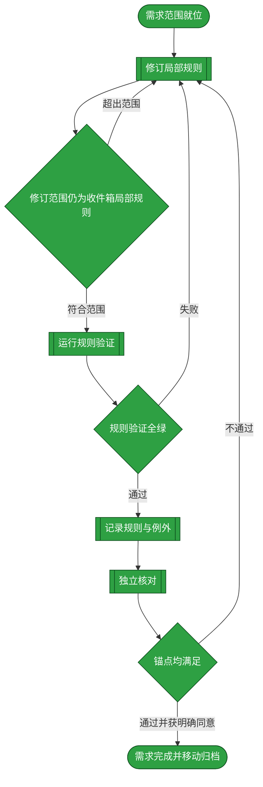
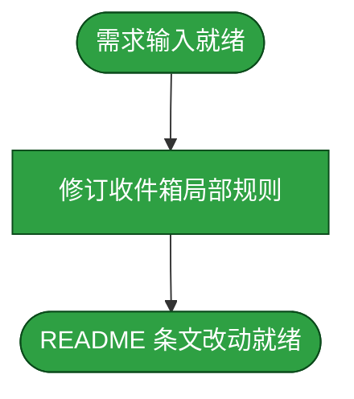
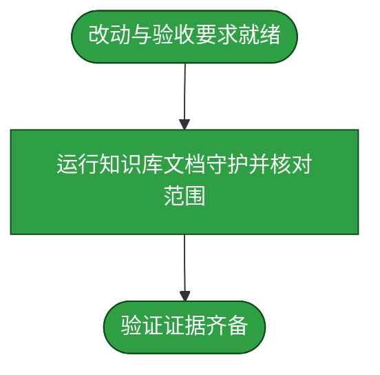
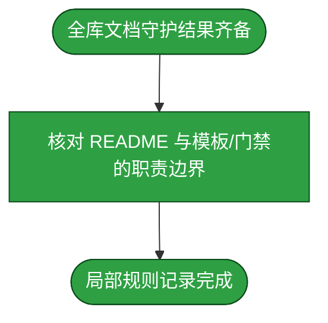
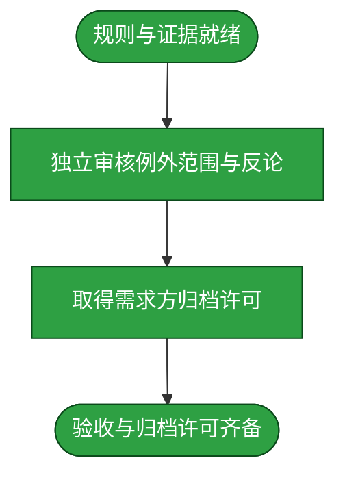

# 需求：明确需求澄清章对 P-02 的收件箱局部例外

```yaml
target: assets/inbox/README.md; assets/inbox/template.md; _lint/_harness/paths.py; _lint/test_sessions_scanner.py; _lint/test_suite_integrity.py; _lint/test_flowdoc_prologue.py
output: assets/inbox/README.md; assets/inbox/template.md; _lint/_harness/paths.py; _lint/test_sessions_scanner.py; _lint/test_suite_integrity.py; _lint/test_flowdoc_prologue.py
prompt:
  - 授权另起规则修订需求并解决冲突
  - 确认该需求记录留在 duoduo
  - 扩展当前 duoduo 规则需求并加回归测试
  - 授权纳入当前政策需求并修复
  - 重写 template.md 以遵守通用 P-01/P-02
```

本需求使需求收件箱的澄清章节、主流程图章节与通用 P-02 之间的适用边界可读且可验证，并使知识库文档发现避开会话临时数据；规则检测只豁免命名为 `req.*.md` 的需求记录及其归档副本，模板与其他普通流程文档继续遵守通用 P-01/P-02。

## 需求澄清

### 澄清记录

- 问答：该知识库方法需求使用哪个非 `main` 记录分支？ → 需求方明确选择 `duoduo`。
  - 裁决：本需求及其后续归档记录均留在知识库 `duoduo`；不切换分支。
  - 反论与代价：把 inbox 专有结构写成局部例外会增加一处特例，且读者需先辨别文档类别；相反让收件箱模板违反 P-02 又不明示例外，会使作者无法同时满足 README、模板和通用流程规范。选择明确限定于需求记录的例外，并由后续门禁核验，避免全局放宽。
  - 验收面：README 明确指出例外的文档范围、澄清章与主图章的次序、主图章自身仍只含一张图；非需求记录仍适用 P-02 原规则。
- 问答：知识库文档发现是否应遍历 DSH 会话临时目录？ → 需求方明确授权扩展当前规则需求并加入回归测试。
  - 裁决：`_lint` 的目录发现跳过根 `.sessions`；回归测试在隔离的临时目录构造模拟 session 内容，不读取本机任何实际会话目录。
  - 反论与代价：跳过目录会漏掉其中的 Markdown；但本工程把 `.sessions` 定义为隔离的临时产物根而非知识文档，扫描它既违反隔离边界又会把一次性输出混入永久文档门禁。只排除这个命名的临时根，其他正常文档发现方式不变。
  - 验收面：隔离 fixture 证明根 Markdown 仍被发现、`.sessions` 下的模拟 Markdown 不会被遍历；全库守护退出码为零且无失败，唯一可接受的跳过是 [test_projects_main_boundary.py](../../_lint/test_projects_main_boundary.py#L40-L47) 对 main 专属边界在内容分支的条件性 skip。
- 问答：是否让 `assets/inbox/` 与 `assets/archive/` 下任意 Markdown 文档都获得 P-02 例外？ → 需求方明确授权将例外收窄到需求文件，并增加普通文件反例。
  - 裁决：只将目录路径与 `req.*.md` 文件身份同时匹配的记录视为需求文档；普通 Markdown 即使位于 inbox 或 archive，也按通用 P-01/P-02/P-10 判定。
  - 反论与代价：文件名匹配增加一处身份判定；但仅按目录放宽会让普通流程文档意外绕过 P-02，影响范围大于需求记录。需求流程的权威文件名规则可由读者直接从 inbox/archive README 取回。
  - 验收面：prologue 测试包含 inbox 与 archive 的合法 `req.*.md` 样例，并包含目录内普通 `.md` 的拒绝样例；全库守护按 A5 通过。
- 问答：`template.md` 作为非需求记录如何满足 P-01/P-02？ → 需求方明确选择重写模板以符合通用规则。
  - 裁决：模板本身采用通用流程文档次序；它仍承载 YAML 字段与澄清章节的示例，但把示例放在主图章节之后，并明确实际 `req.*.md` 需求记录按本 README 的局部例外排列。
  - 反论与代价：模板样例与需求记录的区块次序不同，读者须按 README 复制实际需求形态；反之保留旧模板会让一个非需求流程文档违反 P-01/P-02，并迫使豁免扩大到模板文件。用清晰的用途说明与链接避免抄错。
  - 验收面：模板首个内容块为目标自然段，首个 H2 只含一张主图；模板中的需求元数据与澄清样例仍可取回，prologue 测试将模板当普通流程文件处理。

### 验收锚点

- A1：需求收件箱 README 明确声明仅名称匹配 `req.*.md` 的 inbox 需求记录及其归档副本享有 P-02 局部例外，并限定例外只允许澄清章位于主流程图章之前。
- A2：例外不改变主流程图章只含一张 Mermaid 图的结构，也不改变子流程蓝图在本节点章节内展开的要求。
- A3：模板继续提供 YAML 字段和澄清内容样例，但其本身遵守通用 P-01/P-02；实际需求记录的局部次序由 README 和 provenance 测试规定。
- A4：两个目录下的普通 `.md` 流程文档（包含 `template.md`）及其他非需求流程文档仍按通用 P-01/P-02/P-10 组织；本需求不扩展例外范围。
- A5：知识库文档守护退出码为零且无失败；跳过仅可为 [test_projects_main_boundary.py](../../_lint/test_projects_main_boundary.py#L40-L47) 在内容分支上对 main 专属边界测试的已声明条件性 skip。
- A6：`_lint` 在递归前跳过 `.sessions`；隔离 fixture 证明仓库根文档仍可发现、模拟 session 文档不被访问，且新测试登记在 `GATE_FLOOR`。
- A7：prologue 例外判断同时要求 inbox/archive 路径及 `req.*.md` 文件身份；正向需求记录和两个目录的普通 `.md` 反例均由测试守护。
- A8：`template.md` 作为普通流程文档通过通用 P-01/P-02 prologue 检查，且仍保留所需字段与澄清样例。

### 范围边界

- 不做：修改通用流程文档规范 P-02 的适用范围。
- 不做：改变模板的字段契约、验收锚点或四阶段流程语义；仅重排 `template.md` 的示例区块以符合通用 P-01/P-02。
- 不做：修改项目源码、领域知识、子模块或项目自身测试；门禁范围修订仅限知识库根 `_lint` 的文档发现代码及其隔离回归测试。

## 主流程图



## START

需求方已授权修订本地规则，目标文件、边界、验收锚点及记录分支已确认，规格交给开发阶段执行。

**输入**

- `PROMPT`：本需求的授权与分支选择；来源为本文前置数据块。

**输出**

- `REQ_SPEC`：局部修订范围与目标；去向为 `DEVELOP`。
- `CLARIFICATIONS`：裁决、验收锚点与范围边界；去向为 `DEVELOP`。

## DEVELOP

开发阶段在需求收件箱 README 中说明澄清章与主流程图章对 P-02 的局部关系，重排 `template.md` 的示例区块以遵守通用 P-01/P-02，收窄 prologue 检查对需求文件身份的判定，在知识库根 `_lint` 目录发现中排除 `.sessions`，并将隔离回归测试登记进 `GATE_FLOOR`；不改通用流程规范、模板字段契约或四阶段流程语义。每轮独立开发者（包括返工轮）重读本文前置块的 `REQ_SPEC` 与澄清锚点，并按其目标路径读取当前文件；门禁回边只交接未解缺口与澄清上下文，未变规格和当前文件内容不靠门禁参数副本传递。

**输入**

- `REQ_SPEC`：局部修订范围与目标；来源为 `START`。
- `CLARIFICATIONS`：裁决、验收锚点与范围边界；来源为 `START`、`DEV_GATE`、`TEST_GATE` 或 `ACCEPT_GATE`。
- `REWORK_BRIEF`：门禁失败证据、未解决缺口与修订范围；来源为 `DEV_GATE`、`TEST_GATE` 或 `ACCEPT_GATE`。
- `POLICY_CHANGE`：README 条文改动；来源为 `D_DONE`。

**输出**

- `REQ_SPEC`：局部修订范围与目标；去向为 `D_START`。
- `CLARIFICATIONS`：裁决、验收锚点与范围边界；去向为 `D_START`、`DEV_GATE`。
- `REWORK_BRIEF`：门禁失败证据、未解决缺口与修订范围；去向为 `D_START`。
- `POLICY_CHANGE`：README 条文改动；去向为 `DEV_GATE`。



### D_START

本节点把已确认的修订范围、澄清裁决和返工事项整理成交给开发者的作业书。

**输入**

- `REQ_SPEC`：局部修订范围与目标；来源为 `DEVELOP`。
- `CLARIFICATIONS`：裁决、验收锚点与范围边界；来源为 `DEVELOP`。
- `REWORK_BRIEF`：门禁失败证据、未解决缺口与修订范围；来源为 `DEVELOP`。

**输出**

- `DEV_BRIEF`：README 修改作业书；去向为 `D_EDIT`。

### D_EDIT

把需求记录的特殊排列限定为 inbox/archive 中名称匹配 `req.*.md` 的文件：前置澄清章可先于主流程图章，主流程图章自身仍只含 Mermaid 主图；其他流程文档继续服从 P-02。重排 `template.md` 的示例内容，使模板本身的 H1 后首块为目标段且首个 H2 只含主图。同步修改 prologue 检查，使例外判定同时匹配目录与文件身份，并为 inbox/archive 的普通 `.md` 文件增加拒绝样例；保留根 `.sessions` 下钻剪枝与隔离回归测试。

**输入**

- `DEV_BRIEF`：README 修改作业书；来源为 `D_START`。

**输出**

- `POLICY_CHANGE`：README 条文改动；去向为 `D_DONE`。

### D_DONE

局部例外的范围、理由和保留条件均已写入 README，改动交由开发门禁核对。

**输入**

- `POLICY_CHANGE`：README 条文改动；来源为 `D_EDIT`。

**输出**

- `POLICY_CHANGE`：README 条文改动；去向为 `DEVELOP`。

## DEV_GATE

核对 README 条文改动是否只触及 inbox 需求记录及归档副本，且没有把局部例外扩展到普通流程文档；符合范围时进入测试，否则将缺口退回开发。

**输入**

- `POLICY_CHANGE`：README 条文改动；来源为 `DEVELOP`。
- `CLARIFICATIONS`：裁决、验收锚点与范围边界；来源为 `DEVELOP`。

**输出**

- `POLICY_CHANGE`：README 条文改动；去向为 `TEST`。
- `CLARIFICATIONS`：裁决、验收锚点与范围边界；去向为 `TEST`、`DEVELOP`。
- `REWORK_BRIEF`：门禁失败证据、未解决缺口与修订范围；去向为 `DEVELOP`。

## TEST

测试阶段使用全库文档守护验证该例外与当前需求记录可共存，并确认门禁没有因此放宽其他文档。

**输入**

- `POLICY_CHANGE`：README 条文改动；来源为 `DEV_GATE`。
- `CLARIFICATIONS`：裁决、验收锚点与范围边界；来源为 `DEV_GATE`。
- `TEST_EVIDENCE`：全库文档守护结果；来源为 `T_DONE`。

**输出**

- `POLICY_CHANGE`：README 条文改动；去向为 `T_START`、`TEST_GATE`。
- `TEST_EVIDENCE`：全库文档守护结果；去向为 `TEST_GATE`。
- `CLARIFICATIONS`：裁决、验收锚点与范围边界；去向为 `T_START`、`TEST_GATE`。



### T_START

本节点向独立测试者提供 README 条文改动与验收锚点，界定需要验证的规则与非目标范围。

**输入**

- `POLICY_CHANGE`：README 条文改动；来源为 `TEST`。
- `CLARIFICATIONS`：裁决、验收锚点与范围边界；来源为 `TEST`。

**输出**

- `TEST_SCOPE`：门禁命令、例外范围与反向判定；去向为 `T_RUN`。
- `POLICY_CHANGE`：README 条文改动；去向为 `T_RUN`。
- `CLARIFICATIONS`：裁决、验收锚点与范围边界；去向为 `T_RUN`。

### T_RUN

独立测试者运行 `UV_CACHE_DIR=.uv-cache uv run --with pytest==9.1.1 pytest _lint -q`，并核对 `## 需求澄清` 只作为需求记录的局部预流章节、主流程图章节仍只含一张图、隔离路径 fixture 会排除模拟 `.sessions` 内容，且该回归测试登记在 `_lint/test_suite_integrity.py` 的 `GATE_FLOOR` 中。本轮实测无失败、退出码为零；唯一跳过项是 [test_projects_main_boundary.py](../../_lint/test_projects_main_boundary.py#L40-L47) 在 `duoduo` 内容分支上按 `main` 专属边界规则条件性跳过。

**输入**

- `TEST_SCOPE`：门禁命令、例外范围与反向判定；来源为 `T_START`。
- `POLICY_CHANGE`：README 条文改动；来源为 `T_START`。
- `CLARIFICATIONS`：裁决、验收锚点与范围边界；来源为 `T_START`。

**输出**

- `POLICY_CHANGE`：README 条文改动；去向为 `T_DONE`。
- `TEST_EVIDENCE`：全库文档守护结果；去向为 `T_DONE`。
- `CLARIFICATIONS`：裁决、验收锚点与范围边界；去向为 `T_DONE`。

### T_DONE

测试阶段结果与验收证据齐备后，交给测试门禁判定。

**输入**

- `POLICY_CHANGE`：README 条文改动；来源为 `T_RUN`。
- `TEST_EVIDENCE`：全库文档守护结果；来源为 `T_RUN`。
- `CLARIFICATIONS`：裁决、验收锚点与范围边界；来源为 `T_RUN`。

**输出**

- `POLICY_CHANGE`：README 条文改动；去向为 `TEST`。
- `TEST_EVIDENCE`：全库文档守护结果；去向为 `TEST`。
- `CLARIFICATIONS`：裁决、验收锚点与范围边界；去向为 `TEST`。

## TEST_GATE

只有知识库文档守护退出码为零且无失败、唯一跳过为内容分支上的 main 专属边界测试，且普通流程文档仍按通用 P-02 组织时进入归档；否则将全库文档守护结果和缺口交回开发。

**输入**

- `POLICY_CHANGE`：README 条文改动；来源为 `TEST`。
- `TEST_EVIDENCE`：全库文档守护结果；来源为 `TEST`。
- `CLARIFICATIONS`：裁决、验收锚点与范围边界；来源为 `TEST`。

**输出**

- `POLICY_CHANGE`：README 条文改动；去向为 `ARCHIVE`。
- `TEST_EVIDENCE`：全库文档守护结果；去向为 `ARCHIVE`。
- `CLARIFICATIONS`：裁决、验收锚点与范围边界；去向为 `ARCHIVE`、`DEVELOP`。
- `REWORK_BRIEF`：门禁失败证据、未解决缺口与修订范围；去向为 `DEVELOP`。

## ARCHIVE

归档阶段使 README 的例外条文成为唯一事实源，并确认该文档与需求模板、自动门禁的职责边界一致。

**输入**

- `POLICY_CHANGE`：README 条文改动；来源为 `TEST_GATE`。
- `TEST_EVIDENCE`：全库文档守护结果；来源为 `TEST_GATE`。
- `CLARIFICATIONS`：裁决、验收锚点与范围边界；来源为 `TEST_GATE`。
- `ARCHIVE_RESULT`：例外条文、适用范围与通用 P-02 判据核对结果；来源为 `A_DONE`。

**输出**

- `POLICY_CHANGE`：README 条文改动；去向为 `A_START`、`ACCEPT`。
- `TEST_EVIDENCE`：全库文档守护结果；去向为 `A_START`、`ACCEPT`。
- `CLARIFICATIONS`：裁决、验收锚点与范围边界；去向为 `A_START`、`ACCEPT`。
- `ARCHIVE_RESULT`：例外条文、适用范围与通用 P-02 判据核对结果；去向为 `ACCEPT`。



### A_START

本节点接收规则改动、全库文档守护结果与需求约束，作为核对单一事实源及例外边界的依据。

**输入**

- `POLICY_CHANGE`：README 条文改动；来源为 `ARCHIVE`。
- `TEST_EVIDENCE`：全库文档守护结果；来源为 `ARCHIVE`。
- `CLARIFICATIONS`：裁决、验收锚点与范围边界；来源为 `ARCHIVE`。

**输出**

- `RECORD_INPUT`：待核对的条文与适用范围；去向为 `A_RECORD`。
- `POLICY_CHANGE`：README 条文改动；去向为 `A_RECORD`。
- `TEST_EVIDENCE`：全库文档守护结果；去向为 `A_RECORD`。
- `CLARIFICATIONS`：裁决、验收锚点与范围边界；去向为 `A_RECORD`。

### A_RECORD

核对 README 明确限定需求记录及其归档副本为例外对象，模板与 provenance 门禁仍共同要求澄清内容完整，主图章节本身仍只有流程图。

**输入**

- `RECORD_INPUT`：待核对的条文与适用范围；来源为 `A_START`。
- `POLICY_CHANGE`：README 条文改动；来源为 `A_START`。
- `TEST_EVIDENCE`：全库文档守护结果；来源为 `A_START`。
- `CLARIFICATIONS`：裁决、验收锚点与范围边界；来源为 `A_START`。

**输出**

- `POLICY_CHANGE`：README 条文改动；去向为 `A_DONE`。
- `TEST_EVIDENCE`：全库文档守护结果；去向为 `A_DONE`。
- `CLARIFICATIONS`：裁决、验收锚点与范围边界；去向为 `A_DONE`。
- `ARCHIVE_RESULT`：例外条文、适用范围与通用 P-02 判据核对结果；去向为 `A_DONE`。

### A_DONE

归档阶段确认局部例外只针对需求记录；不存在把例外扩展到普通流程文档的内容。

**输入**

- `POLICY_CHANGE`：README 条文改动；来源为 `A_RECORD`。
- `TEST_EVIDENCE`：全库文档守护结果；来源为 `A_RECORD`。
- `CLARIFICATIONS`：裁决、验收锚点与范围边界；来源为 `A_RECORD`。
- `ARCHIVE_RESULT`：例外条文、适用范围与通用 P-02 判据核对结果；来源为 `A_RECORD`。

**输出**

- `POLICY_CHANGE`：README 条文改动；去向为 `ARCHIVE`。
- `TEST_EVIDENCE`：全库文档守护结果；去向为 `ARCHIVE`。
- `CLARIFICATIONS`：裁决、验收锚点与范围边界；去向为 `ARCHIVE`。
- `ARCHIVE_RESULT`：例外条文、适用范围与通用 P-02 判据核对结果；去向为 `ARCHIVE`。

## ACCEPT

验收阶段由未参与开发和测试的独立审查者核对规则命题、反论、适用范围、全库文档守护结果与需求外变更；通过后取得需求方对归档的明确许可。

**输入**

- `POLICY_CHANGE`：README 条文改动；来源为 `ARCHIVE`。
- `TEST_EVIDENCE`：全库文档守护结果；来源为 `ARCHIVE`。
- `CLARIFICATIONS`：裁决、验收锚点与范围边界；来源为 `ARCHIVE`。
- `ARCHIVE_RESULT`：例外条文、适用范围与通用 P-02 判据核对结果；来源为 `ARCHIVE`。
- `ACCEPTANCE_EVIDENCE`：验收结论、独立审查结果及需求方明确归档许可；来源为 `Q_DONE`。
- `REVIEW_EVIDENCE`：独立审查结论与修订要求；来源为 `Q_DONE`。

**输出**

- `POLICY_CHANGE`：README 条文改动；去向为 `Q_START`。
- `TEST_EVIDENCE`：全库文档守护结果；去向为 `Q_START`。
- `CLARIFICATIONS`：裁决、验收锚点与范围边界；去向为 `Q_START`。
- `ARCHIVE_RESULT`：例外条文、适用范围与通用 P-02 判据核对结果；去向为 `Q_START`。
- `ACCEPTANCE_EVIDENCE`：验收结论、独立审查结果及需求方明确归档许可；去向为 `ACCEPT_GATE`。
- `REVIEW_EVIDENCE`：独立审查结论与修订要求；去向为 `ACCEPT_GATE`。



### Q_START

本节点将规则改动、测试结果、适用范围与反论交给独立审查者。

**输入**

- `POLICY_CHANGE`：README 条文改动；来源为 `ACCEPT`。
- `TEST_EVIDENCE`：全库文档守护结果；来源为 `ACCEPT`。
- `CLARIFICATIONS`：裁决、验收锚点与范围边界；来源为 `ACCEPT`。
- `ARCHIVE_RESULT`：例外条文、适用范围与通用 P-02 判据核对结果；来源为 `ACCEPT`。

**输出**

- `REVIEW_INPUT`：待核验的规则、范围与证据；去向为 `Q_REVIEW`。
- `POLICY_CHANGE`：README 条文改动；去向为 `Q_REVIEW`。
- `TEST_EVIDENCE`：全库文档守护结果；去向为 `Q_REVIEW`。
- `CLARIFICATIONS`：裁决、验收锚点与范围边界；去向为 `Q_REVIEW`。
- `ARCHIVE_RESULT`：例外条文、适用范围与通用 P-02 判据核对结果；去向为 `Q_REVIEW`。

### Q_REVIEW

独立审查者按 A1–A6 核对目标与反论，重点验证局部例外不会把 P-02 泛化到其他流程文档，并检查全库文档守护结果与范围边界。

**输入**

- `REVIEW_INPUT`：待核验的规则、范围与证据；来源为 `Q_START`。
- `POLICY_CHANGE`：README 条文改动；来源为 `Q_START`。
- `TEST_EVIDENCE`：全库文档守护结果；来源为 `Q_START`。
- `CLARIFICATIONS`：裁决、验收锚点与范围边界；来源为 `Q_START`。
- `ARCHIVE_RESULT`：例外条文、适用范围与通用 P-02 判据核对结果；来源为 `Q_START`。

**输出**

- `REVIEW_EVIDENCE`：独立审查结论与修订要求；去向为 `Q_APPROVAL`。
- `POLICY_CHANGE`：README 条文改动；去向为 `Q_APPROVAL`。
- `TEST_EVIDENCE`：全库文档守护结果；去向为 `Q_APPROVAL`。
- `CLARIFICATIONS`：裁决、验收锚点与范围边界；去向为 `Q_APPROVAL`。
- `ARCHIVE_RESULT`：例外条文、适用范围与通用 P-02 判据核对结果；去向为 `Q_APPROVAL`。

### Q_APPROVAL

需求方查看独立审查结论与全库文档守护结果后，明确同意归档；未取得同意时停留在等待状态，不自行归档。

**输入**

- `REVIEW_EVIDENCE`：独立审查结论与修订要求；来源为 `Q_REVIEW`。
- `POLICY_CHANGE`：README 条文改动；来源为 `Q_REVIEW`。
- `TEST_EVIDENCE`：全库文档守护结果；来源为 `Q_REVIEW`。
- `CLARIFICATIONS`：裁决、验收锚点与范围边界；来源为 `Q_REVIEW`。
- `ARCHIVE_RESULT`：例外条文、适用范围与通用 P-02 判据核对结果；来源为 `Q_REVIEW`。
- `REQUESTER_REPLY`：需求方明确归档决定；来源为流程外部确认。

**输出**

- `REVIEW_EVIDENCE`：独立审查结论与修订要求；去向为 `Q_DONE`。
- `POLICY_CHANGE`：README 条文改动；去向为 `Q_DONE`。
- `TEST_EVIDENCE`：全库文档守护结果；去向为 `Q_DONE`。
- `CLARIFICATIONS`：裁决、验收锚点与范围边界；去向为 `Q_DONE`。
- `ARCHIVE_RESULT`：例外条文、适用范围与通用 P-02 判据核对结果；去向为 `Q_DONE`。
- `ACCEPTANCE_EVIDENCE`：验收结论、独立审查结果及需求方明确归档许可；去向为 `Q_DONE`。

### Q_DONE

验收结论、需求方许可及证据齐备后，交给验收门禁判定。

**输入**

- `REVIEW_EVIDENCE`：独立审查结论与修订要求；来源为 `Q_APPROVAL`。
- `POLICY_CHANGE`：README 条文改动；来源为 `Q_APPROVAL`。
- `TEST_EVIDENCE`：全库文档守护结果；来源为 `Q_APPROVAL`。
- `CLARIFICATIONS`：裁决、验收锚点与范围边界；来源为 `Q_APPROVAL`。
- `ARCHIVE_RESULT`：例外条文、适用范围与通用 P-02 判据核对结果；来源为 `Q_APPROVAL`。
- `ACCEPTANCE_EVIDENCE`：验收结论、独立审查结果及需求方明确归档许可；来源为 `Q_APPROVAL`。

**输出**

- `REVIEW_EVIDENCE`：独立审查结论与修订要求；去向为 `ACCEPT`。
- `POLICY_CHANGE`：README 条文改动；去向为 `ACCEPT`。
- `TEST_EVIDENCE`：全库文档守护结果；去向为 `ACCEPT`。
- `CLARIFICATIONS`：裁决、验收锚点与范围边界；去向为 `ACCEPT`。
- `ARCHIVE_RESULT`：例外条文、适用范围与通用 P-02 判据核对结果；去向为 `ACCEPT`。
- `ACCEPTANCE_EVIDENCE`：验收结论、独立审查结果及需求方明确归档许可；去向为 `ACCEPT`。

## ACCEPT_GATE

只在 A1–A6 均由对应规则、门禁或审查证据支持，且需求方明确同意归档后完成；任一未满足时交回开发。

**输入**

- `POLICY_CHANGE`：README 条文改动；来源为 `ACCEPT`。
- `TEST_EVIDENCE`：全库文档守护结果；来源为 `ACCEPT`。
- `CLARIFICATIONS`：裁决、验收锚点与范围边界；来源为 `ACCEPT`。
- `ARCHIVE_RESULT`：例外条文、适用范围与通用 P-02 判据核对结果；来源为 `ACCEPT`。
- `ACCEPTANCE_EVIDENCE`：验收结论、独立审查结果及需求方明确归档许可；来源为 `ACCEPT`。
- `REVIEW_EVIDENCE`：独立审查结论与修订要求；来源为 `ACCEPT`。

**输出**

- `ACCEPTANCE_EVIDENCE`：验收结论、独立审查结果及需求方明确归档许可；去向为 `DONE`。
- `REWORK_BRIEF`：门禁失败证据、未解决缺口与修订范围；去向为 `DEVELOP`。
- `CLARIFICATIONS`：裁决、验收锚点与范围边界；去向为 `DEVELOP`。

## DONE

所有完成路径节点均已执行并标绿；取得需求方明确同意后，按[归档规则](../../assets/archive/README.md)将本文整篇移动到 `assets/archive/`，保持文件名不变并停止修改。

**输入**

- `ACCEPTANCE_EVIDENCE`：验收结论、独立审查结果及需求方明确归档许可；来源为 `ACCEPT_GATE`。

**输出**

- `ARCHIVE_MOVE`：整篇文档移至 `assets/archive/`；去向为流程外部归档操作。
