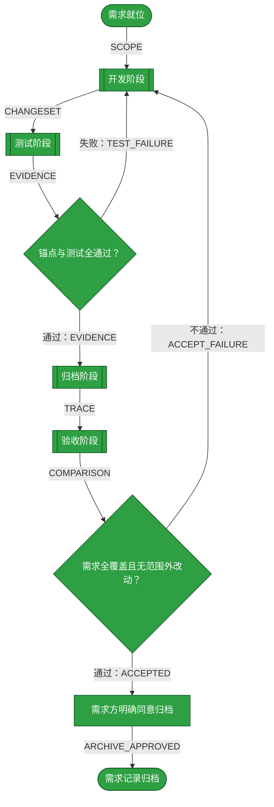
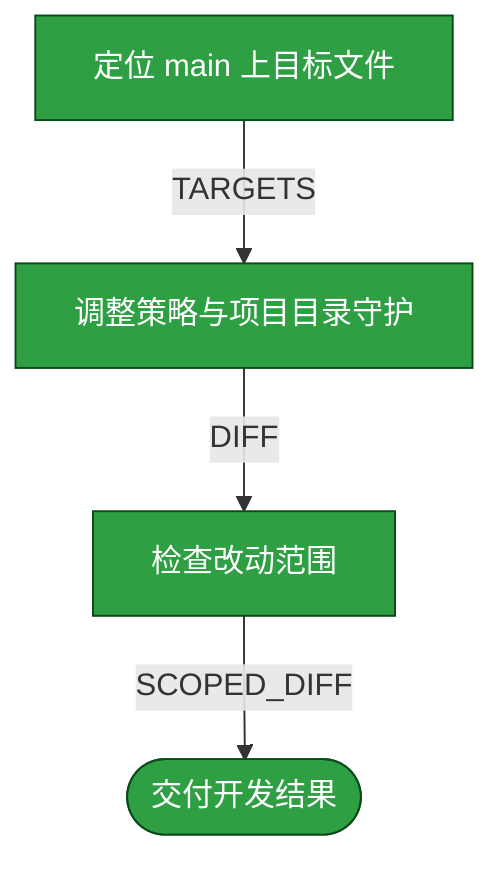
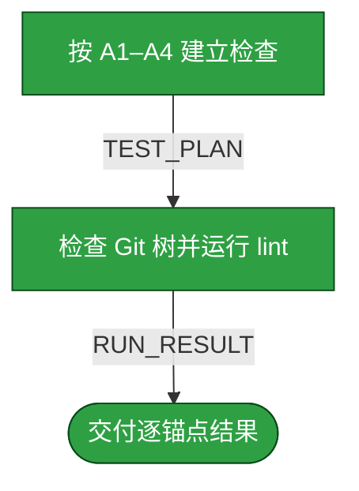
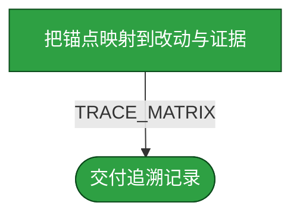
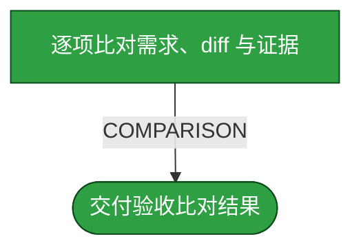

# 需求：让 main 的 projects 目录保持为空

```yaml
target:
  - main 分支 AGENTS.md 的 projects 边界与阅读方式
  - main 分支 _lint 项目目录守护与测试登记
  - main 分支 assets/projects 项目定义文件
  - assets/archive/README.md 的归档分支与发布边界
output:
  - main 的 assets/projects/ 仅保留 .gitkeep
  - duoduo 上的实际项目材料保持不变
  - main 策略和 lint 与该边界一致
  - archive README 的记录分支规则与当前需求政策一致
prompt:
  - 当前KB的git管理有点问题，assets/porjects下有很多project，实际这些应该留存在duoduo这个branch中。
  - 但是我看现在的githubmain分支上还保留projects下面的字目录，比如dsh-credentials
  - 这些也不保留，projects应该是空的
  - 授权提交、推送并创建 PR
  - 同意归档
  - 扩展范围并对齐 README
```

本需求修正知识库的分支边界：`main` 只承载通用结构与方法，`assets/projects/` 不保留项目子目录或 `project.yaml`；`duoduo` 上的实际项目材料保持不变。本流程要求策略、守护、测试通过，并在用户授权后提交、推送候选分支及创建以 `main` 为目标的 PR；不自动合并。

## 需求澄清

### 澄清记录

- 问答：main 的 `assets/projects/` 是否连子目录与 `project.yaml` 定义也应移除？ → “这些也不保留，projects应该是空的”。
  - 裁决：main 的 `assets/projects/` 只保留 Git 空目录占位文件；移除 main 上的项目定义文件，`duoduo` 上实际项目材料保持原样。
  - 反论与代价：main 不再自带项目清单、克隆目录映射或内容分支元数据，读者必须切换到 `duoduo` 取项目事实；若消费者必须从 main 离线发现项目清单，此方案错误。
  - 验收面：main 的目录树只有 `.gitkeep`，lint 拒绝其他成员，duoduo 项目目录内容不受本次改动影响。
- 问答：是否授权提交、推送并创建 PR？ → “授权提交、推送并创建 PR”。
  - 裁决：授权在候选分支提交、推送到 GitHub 并创建目标为 `main` 的 PR；不含 PR 合并、强推或删除远端对象。
  - 反论与代价：PR 需审核且不会立即改变 `main`；保留独立审核与合并门槛，承担等待合并的代价。
  - 验收面：提交在候选分支，PR base 为 `main`，改动仅含本需求范围，未自动合并。
- 问答：是否同意归档本需求记录？ → “同意归档”。
  - 裁决：验收通过后允许整篇移动归档；归档分支按需求方明确确认的非 `main` 记录分支规则执行。
  - 反论与代价：若归档 README 的发布策略仍要求 `main`，当前归档分支约定将冲突；移动前先按需求方确认的非 `main` 规则处理，不把流程记录发布到 `main`。
  - 验收面：记录只在 inbox 或已确认的非 `main` archive 分支存在一次，且移动前先解决与 archive README 的冲突。
- 问答：是否将 archive README 纳入范围并按非 `main` 记录分支规则修订？ → “扩展范围并对齐 README”。
  - 裁决：归档 README 应要求需求记录留在需求方确认的非 `main` 分支；本条记录的 `duoduo` 目标由需求方明确选择，项目资料与策略 PR 仍分开管理。
  - 反论与代价：独立内容分支增加规则维护面，且错误分支确认会使流程记录难以发现；只按需求方本轮明确确认的 `duoduo` 更新 README，并在本记录中保留分支确认与验收证据。
  - 验收面：README 不再要求把 `req.*` 记录发布到 `main`；本需求记录归档后仅存在于 `duoduo/assets/archive/`。

### 验收锚点

- A1：main 的 `assets/projects/` 只包含 `.gitkeep`，不存在任何项目子目录、定义或实际内容。
- A2：main 的文档与 `_lint` 不再要求或读取项目定义，并通过测试拒绝任何额外目录项。
- A3：`duoduo` 上的实际项目材料未被本需求删除、移动或改写。
- A4：候选 main 策略改动的知识库 lint 全绿且退出码为 0。
- A5：候选分支有一笔可复核提交，远端候选分支已推送，并存在以 `main` 为 base 的 PR；不自动合并。
- A6：获准后，本记录整篇从 inbox 移至 `duoduo/assets/archive/`，不在 `main` 留副本。
- A7：`assets/archive/README.md` 要求需求记录留在需求方确认的非 `main` 分支，且其发布与 main 策略 PR 分开。

### 范围边界

- 不做：改动 `duoduo` 上的项目文件、笔记或其他需求记录。
- 不做：合并 PR、强制推送、改写共享历史或删除远端分支。
- 不做：改动各项目独立仓库内的源码、配置或测试。

## 主流程图



## START

需求范围、锚点和发布限制已就位，允许开始本地改动。本节点无分支。

**输入**

- 无。

**输出**

- `SCOPE`：本需求范围及 A1–A4；去向为 `DEVELOP`。

## DEVELOP

开发阶段只改 main 的通用策略、项目定义守护与项目定义文件；不改 `duoduo` 项目材料，也不执行远端发布。它按下面的子流程走。

**输入**

- `SCOPE`：本需求范围及锚点；来源为 `START`。
- `TEST_FAILURE`：未通过锚点及失败证据（若有）；来源为 `TEST_GATE`。
- `TEST_VERDICT`：测试通过或失败判定；来源为 `TEST_GATE`。
- `ACCEPT_FAILURE`：漏改项或范围外改动（若有）；来源为 `ACCEPT_GATE`。
- `CHANGESET`：子流程交付的改动；来源为 `D_OUT`。

**输出**

- `CHANGESET`：策略、守护与项目目录变更；去向为 `TEST`。
- `SCOPE`：本阶段范围；去向为 `D_SCOPE`。



### D_SCOPE

依据 `SCOPE` 确认修改对象均属于 main 的策略、守护和项目目录；不扩展到 `duoduo` 内容文件。

**输入**

- `SCOPE`：修改范围；来源为 `DEVELOP`。

**输出**

- `TARGETS`：本阶段允许修改的文件；去向为 `D_EDIT`。

### D_EDIT

将 main 项目目录收敛为仅含 `.gitkeep`，删除项目定义，并更新策略、测试和测试登记。

**输入**

- `TARGETS`：允许修改的文件；来源为 `D_SCOPE`。

**输出**

- `DIFF`：本次实现差异；去向为 `D_CHECK`。

### D_CHECK

检查完整差异不含 `duoduo` 文件、项目克隆代码或未经授权的版本操作。

**输入**

- `DIFF`：本次实现差异；来源为 `D_EDIT`。

**输出**

- `SCOPED_DIFF`：边界内的改动；去向为 `D_OUT`。

### D_OUT

交付边界内的工作区改动。

**输入**

- `SCOPED_DIFF`：已核对改动；来源为 `D_CHECK`。

**输出**

- `CHANGESET`：改动清单；去向为 `DEVELOP`。

## TEST

测试阶段按 A1–A4 逐项取证；静态树检查与知识库 lint 足以证明本需求的可观察面。测试执行者不改产品文件，失败证据返回开发阶段。

**输入**

- `CHANGESET`：开发改动；来源为 `DEVELOP`。
- `EVIDENCE`：子流程交付的证据；来源为 `T_REPORT`。

**输出**

- `EVIDENCE`：逐锚点结果、命令和退出码；去向为 `TEST_GATE`。
- `CHANGESET`：开发改动；去向为 `T_PLAN`。



### T_PLAN

把 A1–A4 转成可复核的树成员、文本引用、测试结果和版本状态检查。

**输入**

- `CHANGESET`：开发改动；来源为 `TEST`。

**输出**

- `TEST_PLAN`：逐锚点检查方案；去向为 `T_RUN`。

### T_RUN

核对 main 工作树项目目录、策略引用、duoduo 改动差异与知识库 lint 执行结果。

**输入**

- `TEST_PLAN`：逐锚点检查方案；来源为 `T_PLAN`。

**输出**

- `RUN_RESULT`：命令、退出码和检查观察；去向为 `T_REPORT`。

### T_REPORT

仅将可复算检查结果报告给主流程，不把未执行的远端操作写成已发布。

**输入**

- `RUN_RESULT`：测试结果；来源为 `T_RUN`。

**输出**

- `EVIDENCE`：逐锚点证据；去向为 `TEST`。

## TEST_GATE

判定 A1–A4 是否均由实际证据证明，且知识库 lint 全绿、退出码为 0；失败时交付失败项，不以降低断言取得通过。

**输入**

- `EVIDENCE`：逐锚点测试证据；来源为 `TEST`。

**输出**

- `TEST_VERDICT`：通过或失败判定；去向为 `ARCHIVE` 或 `DEVELOP`。
- `TEST_FAILURE`：失败锚点与证据；去向为 `DEVELOP`。

## ARCHIVE

归档阶段把已验证的策略与改动事实记录在本需求的追溯表中；不移动此流程文档，也不将版本发布状态伪记为完成。

**输入**

- `EVIDENCE`：测试证据；来源为 `TEST_GATE`。
- `TEST_VERDICT`：测试阶段判定；来源为 `TEST_GATE`。
- `CHANGESET`：开发改动清单；来源为 `DEVELOP`。
- `TRACE`：子流程交付的追溯矩阵；来源为 `A_OUT`。

**输出**

- `TRACE`：逐锚点实现、测试与发布状态指针；去向为 `ACCEPT`。
- `EVIDENCE`：测试证据；去向为 `A_MAP`。
- `CHANGESET`：开发改动清单；去向为 `A_MAP`。



### A_MAP

将每个锚点映射到具体路径及测试证据；尚未提交或发布的状态明确标注未执行。

**输入**

- `EVIDENCE`：逐锚点测试证据；来源为 `ARCHIVE`。
- `CHANGESET`：改动清单；来源为 `ARCHIVE`。

**输出**

- `TRACE_MATRIX`：锚点与实现、测试及版本状态映射；去向为 `A_OUT`。

| 锚点 | 实现路径与状态 | 测试证据与状态 | 未验证面 | 发布状态 |
| --- | --- | --- | --- | --- |
| A1 | 候选 main 分支工作树、索引与提交树的 `assets/projects/` 仅保留 `.gitkeep`；已验证 | `test_projects_main_boundary.py` 核对文件系统与 Git 索引；全套 lint 命令退出码 0 | GitHub main 尚未更新 | 本地提交 `1fc0726` |
| A2 | 候选 main `AGENTS.md` 与 `_lint/README.md` 均描述项目目录为空；已验证 | `UV_CACHE_DIR=.uv-cache uv run --with pytest==9.1.1 pytest _lint -q`，全绿，退出码 0 | 远端 main 变更未发布 | 未推送 |
| A3 | 本次候选 main diff 未触及 duoduo；已核对 | 候选 diff 仅含 main 根文件；duoduo 项目目录状态与本任务开始时记录相同 | duoduo 工作区有会话既有差异，内容未由本需求修改 | 不涉及 |
| A4 | 候选提交已创建；已验证 | 提交 hook 自动运行 `_lint` 并全绿；退出码 0 | GitHub main 尚未更新 | 已提交本地候选 |
| A5 | 候选提交与文件范围已核验；已验证 | `gh auth status --hostname github.com` 认证失败，默认 collection `Locked` 属性仍为 `true`；未推送、未创建 PR | keyring 解锁由用户尝试后仍未解锁；远端操作停止 | 推送/PR 已授权但受认证阻塞 |
| A6 | 需求方同意归档，且明确选择 `duoduo` 为记录分支；已验证 | [archive README](../archive/README.md) 已更新为非 `main` 记录边界 | 归档移动是本流程终端操作 | 获授权，按流程执行 |
| A7 | `assets/archive/README.md` 明确分离记录分支与 main 策略 PR；已验证 | 归档 README 数量/引用检查与链接检查通过 | duoduo README 改动尚未提交或推送 | 本地工作区改动 |

#### 版本控制记录

- 仓库/分支：knowledge-base / `policy/main-projects-empty-20261014`，基线 `origin/main` 的 `209b74b`
- 结果提交：`1fc0726`；候选提交的 `assets/projects/` 仅含 `.gitkeep`
- PR/发布：候选分支提交 `1fc0726`；未推送、未创建 PR。`gh auth status` 报认证无效，默认 Secret Service collection 仍锁定，停止远端操作
- 归档记录分支：`duoduo`；已获需求方明确同意，流程终端移动后不在移动文档上补写
- 提交/推送/合并/发布授权：候选分支提交、推送与创建 `main` PR 已授权；PR 合并未授权；本地提交已执行，推送与 PR 未执行

### A_OUT

交付追溯记录，不代替验收结论。

**输入**

- `TRACE_MATRIX`：追溯矩阵；来源为 `A_MAP`。

**输出**

- `TRACE`：追溯矩阵；去向为 `ARCHIVE`。

## ACCEPT

验收阶段由与前三阶段独立的执行者，只依据需求、锚点、完整差异、测试证据和追溯记录逐项比对；不自行修正。

**输入**

- `SCOPE`：需求及锚点；来源为 `START`。
- `TRACE`：实现与验证指针；来源为 `ARCHIVE`。
- `EVIDENCE`：测试证据；来源为 `TEST_GATE`。
- `COMPARISON`：子流程交付的比对结果；来源为 `C_OUT`。

**输出**

- `COMPARISON`：逐项对应关系；去向为 `ACCEPT_GATE`。
- `SCOPE`：需求与锚点；去向为 `C_COMPARE`。
- `TRACE`：追溯记录；去向为 `C_COMPARE`。
- `EVIDENCE`：测试证据；去向为 `C_COMPARE`。



### C_COMPARE

列出每项需求要求及其对应改动或缺失，并检查是否存在追溯不到需求的额外改动。

**输入**

- `SCOPE`：原始需求与验收锚点；来源为 `ACCEPT`。
- `TRACE`：追溯记录；来源为 `ACCEPT`。
- `EVIDENCE`：测试证据；来源为 `ACCEPT`。

**输出**

- `COMPARISON`：逐条覆盖及范围判定；去向为 `C_OUT`。

### C_OUT

将独立验收者的比对结果交回主流程。

**输入**

- `COMPARISON`：逐条验收比对；来源为 `C_COMPARE`。

**输出**

- `COMPARISON`：验收比对结果；去向为 `ACCEPT`。

## ACCEPT_GATE

只有需求全部实现且不存在需求外改动才通过；任何遗漏或额外改动都回开发阶段。

**输入**

- `COMPARISON`：逐条比对结果；来源为 `ACCEPT`。

**输出**

- `ACCEPTED`：通过判定；去向为 `REQUESTER_APPROVAL`。
- `ACCEPT_FAILURE`：遗漏或额外改动；去向为 `DEVELOP`。

## REQUESTER_APPROVAL

验收通过后，需求方已明确同意将本流程记录归档；该同意不等于 PR 合并授权。

**输入**

- `ACCEPTED`：逐锚点验收通过；来源为 `ACCEPT_GATE`。

**输出**

- `ARCHIVE_APPROVED`：需求方明确同意归档；去向为 `DONE`。

## DONE

需求方已同意将记录整篇移动到 `duoduo/assets/archive/`；移动完成后不再修改本文件。main 策略候选的推送与 PR 是独立的归档后发布步骤；认证未恢复前不得声称已发布，PR 合并仍未授权。

**输入**

- `ARCHIVE_APPROVED`：需求方明确同意归档；来源为 `REQUESTER_APPROVAL`。

**输出**

- `ARCHIVE_MOVE`：将本需求文件整篇移动到 `assets/archive/`；去向为流程外部的归档操作。
