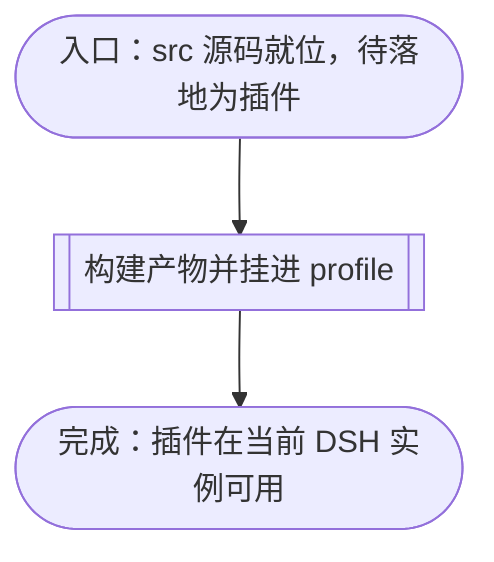
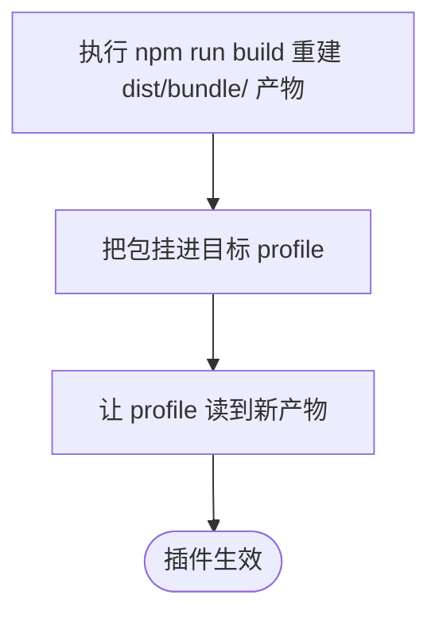

# 源码落地为插件的流程

本文档是 dsh-workbench 的单项目插件落地流程样本：从源码与构建输入在工程根就位开始，经构建产出 bundle 产物、把包挂进目标 profile，到插件在当前 DSH 实例里可用为止。各步骤的操作命令、校验判据、生效时机与失败模式在逐节点章节中展开；它不作为 knowledge-base 或其它项目的部署入口，knowledge-base 自身环境部署见 [KB 部署指南](../../../deploy.md)。

## 主流程图



## START_WITH_SOURCE

本节点是流程入口，确认落地所需的输入与工具链已在工程根就位。本节点不出分支，唯一出边通向 `DELIVER_BUNDLE`。

工程根即本工作树，下文命令均以它为 cwd，命令中的相对路径一律相对工程根解析。

`plugin-loader` 是工程根的同级兄弟目录（仓库相对路径 `../plugin-loader`），**不经 `node_modules` 使用**。它的路径在 `tools.config.json` 的 `bundleTool` 声明一处，`build:bundle` 由此现取（见 `package.json` 的该脚本，本文件不抄写路径）。由此导出三条契约：它**不是**本工程的依赖项，`package.json` 里没有它，`node_modules/` 下也没有它的副本；改工具链**立即生效**，无需任何同步，单一事实源就是这个目录；它是构建期工具，**不随包分发**（`files` 字段不含它），只有开发/构建时需要在同级就位。

该前置条件是可执行的：`build:bundle` 先跑 `check:bundle-tool`，后者按 `bundleTool` 解析出绝对路径并核对其存在。缺失时打包以非零码退出，并指名缺的是哪个目录、应放在哪里；**不会**退化成 `MODULE_NOT_FOUND`。故"只检出本仓库"的环境里 `npm pack` 的结论是一条可读的诊断，而不是一个看起来像仓库损坏的模块解析错误。判据：在 `git archive` 落出的临时目录（无 `node_modules`、无兄弟目录）里跑 `npm run prepack`，退出码非零且输出含 `bundleTool`。

`node_modules/` 已就位（含 esbuild、playwright）；**除非依赖变更，不要重跑安装**。若确实要重装，用 `npm ci`——本工程以 `package-lock.json` 为唯一权威；**不要用 pnpm**，仓库不保留 `pnpm-lock.yaml`。

**输入**

- `WORKBENCH_ROOT`：路径；来源为工程部署位置。

**输出**

- `SOURCE_READY`：就位状态；去向为 `DELIVER_BUNDLE`。

**失败模式**

`plugin-loader` 若被以 `file:../plugin-loader` 声明为依赖，npm 会装成**拷贝**——改了工具链源文件却不生效，且无任何报错。

兄弟目录缺席时，`build:bundle` 由 `check:bundle-tool` 报出，构建和打包一并失败；产物缺失不会伪装成包管理器故障。


## DELIVER_BUNDLE

本节点承载落地子流程：同一份源码经 `npm run build` 重新产出 `dist/bundle/` 下的 host 与 client 产物，再经官方通道把包挂进目标 profile，最后让 profile 读到新产物。本节点不出分支，唯一出边通向 `PLUGIN_LIVE`。

**输入**

- `SOURCE_READY`：就位状态；来源为 `START_WITH_SOURCE`。

**输出**

- `PLUGIN_ACTIVE`：运行状态；去向为 `PLUGIN_LIVE`。



### BUNDLE_BUILD

本节点执行 `npm run build`（等价于 `npm run build:bundle`），把 `src/` 打包成 `dist/bundle/index.mjs`（host 半）与 `dist/bundle/client.js`（client 半）。构建是幂等的：同源必得同产物。本节点不出分支，唯一出边通向 `BUNDLE_MOUNT`。

**输入**

- `WORKBENCH_ROOT`：路径；来源为工程部署位置。

**输出**

- `BUNDLE_DIST`：产物目录路径；去向为 `BUNDLE_MOUNT`。

### BUNDLE_MOUNT

本节点把产物挂进目标 profile。挂载方式由 `package.json` 与 `bundle.patch.yml` 共同定义。

`package.json`：`main`/`exports` 指向 `dist/bundle/*`；`dsh.bundle.patch` 指向 `bundle.patch.yml`；`dsh.client.inject` 声明 client 半必须先装载到位的宿主客户端模块（以该字段的实际列表为准）。这不是产物内的 import 清单，而是宿主的装载顺序契约；移除某项前，须从当前构建产物确认它不再被引用。

`bundle.patch.yml`：把插件行 `insert` 进 profile 组合树。其中的 `!!js` 条件是**双挂载守卫**——若已有别的 entry 挂了 `dsh-workbench`（如某个聚合 bundle），本行自动让位，避免两条挂载重复注册 `/dsh-workbench/*` 路由。守卫只能看见排在它之前的行，故聚合 bundle 必须排在本行之前（`dsh plugin add` 追加到末尾，恰为默认顺序）；反序是已知限制。

用户侧挂载即官方通道；从工程根目录执行，`$PWD` 指向当前工程根：

```bash
dsh plugin --profile <name> add file:"$PWD"
```


`npm pack --dry-run --cache "$PWD/.npm-cache"` 的输出是实际分发清单；`package.json` 的 `files` 字段是声明的包含规则，不替代对打包结果的检查。核对清单是否含挂载配置、入口清单、构建产物及项目要求随包分发的许可证文件，并核对 `package.json` 的许可证声明与许可证文件一致；npm 可能按默认规则包含部分文件，因此不得仅由 `files` 字段推断最终包内容。宿主默认缓存目录不可写时，显式指定工作区缓存。

本节点不出分支，唯一出边通向 `BUNDLE_RELOAD`。

**输入**

- `BUNDLE_DIST`：产物目录路径；来源为 `BUNDLE_BUILD`。

**输出**

- `PROFILE_ENTRY`：profile 组合树里的挂载项；去向为 `BUNDLE_RELOAD`。

### BUNDLE_RELOAD

本节点让运行中的 DSH 读到新产物。DSH 默认不重读磁盘：host 半 ESM 按 URL 缓存，同一路径不重读，故产物更换后须重启 DSH 才生效。

开发期可改为免重启生效，但须同时满足两个条件：挂载为**符号链接**，且加载器 import 的真实路径**不含 `node_modules`**。`dsh-hmr` 的默认 `ignored` 含 `**/node_modules`；路径落在其中时，变更分析会把模块判为 declined，单设 `ignored: []` 不能解除。若本地文件依赖被包管理器投影到 `node_modules`，其 realpath 就不满足此条件；这种挂载不能声称支持免重启热更新。改用 `add link:` 时，还须在 profile 的 `cordis.patch.yml` 为 HMR 配置非空 `root`。

两类改动的重启代价不同：补写或修正 HMR 条目无需重启，运行中的实例会拾取配置变更，其后改产物即生效；改变挂载形态（`file:` 与 `link:`）必须重启，已加载 profile 不会重新解析模块路径。本节点不出分支，唯一出边通向 `BUNDLE_LIVE`。

**输入**

- `PROFILE_ENTRY`：挂载项；来源为 `BUNDLE_MOUNT`。

**输出**

- `PLUGIN_ACTIVE`：运行状态；去向为 `BUNDLE_LIVE` 与 `PLUGIN_LIVE`。

### BUNDLE_LIVE

本节点是子流程的结束节点，表示插件已生效。本节点无出边。

**输入**

- `PLUGIN_ACTIVE`：运行状态；来源为 `BUNDLE_RELOAD`。

**输出**

- 无。

## PLUGIN_LIVE

本节点是主流程的结束节点：落地流程在此收束，插件在当前 DSH 实例可用。本节点无出边。

**输入**

- `PLUGIN_ACTIVE`：运行状态；来源为 `DELIVER_BUNDLE`。

**输出**

- 无。
